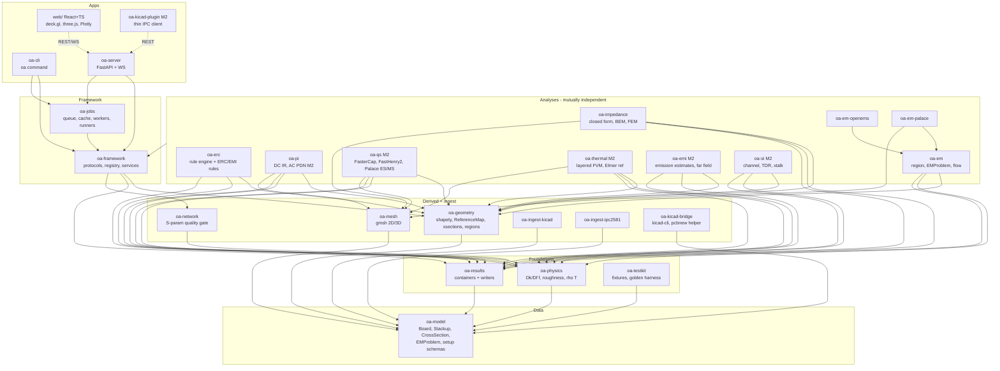
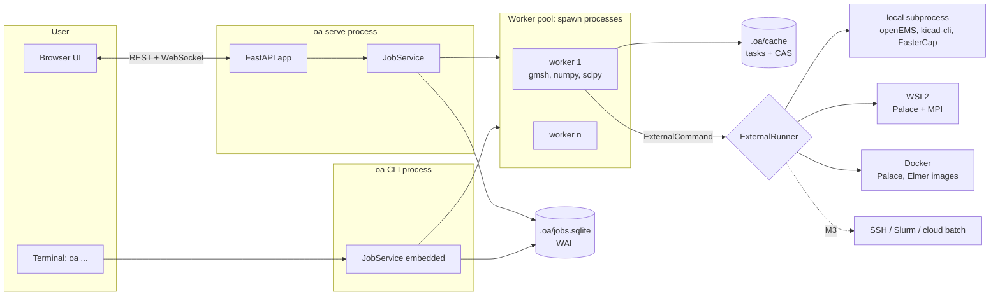

# Open_Analysis Architecture

Status: v1, 2026-10-27. Normative for every implementation work package. The detailed contracts are in [specs/board-model.md](specs/board-model.md) and [specs/interfaces.md](specs/interfaces.md). Decisions are recorded in [adr/](adr/).

Open_Analysis is a GPL-3.0-or-later PCB analysis suite. It reads KiCad boards (and Altium and others through kicad-cli and IPC-2581), and it provides:
- trace impedance;
- electrical/EMI rule checks;
- signal integrity;
- power integrity (DC IR and AC PDN);
- 3D full-wave S-parameters;
- 3D quasi-static RLC extraction;
- thermal analysis;
- EMI estimates.

The long-term target is feature parity with SIwave, HFSS, Q3D and HyperLynx.

## 1. Principles

1. **One neutral board model.** Every reader produces `oa_model.Board`, and every analysis consumes it. Nothing downstream knows about KiCad tokens.
2. **Headless core, many clients.** The CLI (`oa`), the local web UI, CI and agents/MCP all use the same Python API. The REST server is a thin layer over it. The core never imports UI code.
3. **Contracts first.** Packages talk through frozen, versioned pydantic types. Parallel teams implement against the specs, not against each other's code.
4. **Validation is a feature.** Every solver ships with golden-reference tests (analytic, published, cross-solver). Every S-parameter result passes a quality gate. Every quasi-static or model-based result states its valid frequency range.
5. **Solvers are jobs.** Anything heavier than a millisecond runs as a cacheable task in the job system. External solvers run as subprocesses in self-contained job directories, using pluggable runners (local, WSL, Docker, and later SSH/Slurm and cloud).
6. **Deterministic and content-addressed.** The same inputs (board hash, physics hash, setup, solver versions) give the same cache key and the same result.
7. **Python first, native later.** NumPy/SciPy/shapely/gmsh carry the hot paths. Rust (PyO3) goes in only where profiling shows a need (ADR-0002).

## 2. Package diagram



Layering is enforced by import-linter (interfaces.md §0):
- An analysis package never imports another analysis package. Cross-analysis needs, such as ERC asking for impedance or thermal asking for the DC Joule heat, go through `oa_framework.services`, which the registry resolves at runtime. This keeps the Wave 1/2 work packages independent.
- `oa_em_openems` and `oa_em_palace` are the only allowed intra-L4 imports (adapters on top of `oa_em`).

### Repository layout

```
Open_Analysis/
  pyproject.toml            uv workspace root, ruff/mypy/pytest/import-linter config
  uv.lock
  LICENSE                   GPL-3.0-or-later;  LICENSES/ (REUSE)
  packages/<pkg>/           pyproject.toml, src/<import_name>/, tests/
  web/                      Vite + React + TS (pnpm); src/api/ generated client
  schemas/                  generated JSON Schemas (board-model.v1.json, ...), CHANGELOG.md
  tests/
    boards/kicad10/         synthetic KiCad 10 boards (WP-102) + expected.yaml each
    fixtures/model/         .oab.json fixtures from oa-testkit builders
    golden/<suite>/<case>/  case.toml + reference data
    integration/            cross-package tests (WP-208, WP-302)
  tools/                    dev scripts (board generators, schema export, golden regeneration)
  docs/                     ARCHITECTURE, ROADMAP, TASKS, specs/, adr/, research/, validation/
```

## 3. Data flow

```mermaid
flowchart LR
  F1[.kicad_pcb + .kicad_pro] --> R1[oa-ingest-kicad]
  F2[IPC-2581 .xml] --> R2[oa-ingest-ipc2581]
  F3[.PcbDoc / Allegro / PADS] --> KB1[kicad-cli pcb import<br/>subprocess] --> R1
  KB2[pcbnew helper<br/>zone refill, subprocess] -.optional.-> R1
  R1 & R2 --> B[Board v1<br/>raw]
  P[oa-physics.yaml<br/>sidecar] --> AP[apply_physics]
  B --> AP --> BP[Board v1<br/>with physics]
  I[oa/intent.yaml] --> RI[resolve_intent]
  BP --> RI
  BP --> G[BoardGeometry<br/>unions, STRtree, NetTopology,<br/>ReferenceMap]
  S[oa/setups/*.yaml<br/>ports, loads, rules] --> PL
  G --> PL[Analysis.plan<br/>Tasks]
  RI --> PL
  PL --> XS[CrossSection] --> IMPS[impedance service]
  PL --> MSH[gmsh meshes<br/>xsection, copper sheets, OCC 3D]
  PL --> EMPR[EMProblem / QSProblem /<br/>ThermalProblem]
  MSH --> SOLV[in-house solvers<br/>BEM, FEM, DC FEM, FVM]
  EMPR --> AD[Solver adapters<br/>openEMS, Palace, FasterCap...]
  AD --> EXT[external process<br/>job dir]
  IMPS & SOLV & EXT --> RED[Analysis.reduce]
  RED --> QG{quality gate<br/>S-params, matrices}
  QG --> RB[ResultBundle<br/>network, field, table,<br/>violations, profile]
  RB --> UI[web UI / CLI / SARIF /<br/>Touchstone / VTU / HTML]
```



Stage by stage:

1. **Ingest.**
   - The reader turns file bytes into a raw `Board` (SI metres, Y-up, z from the bottom).
   - Readers validate (`validate_board`) and attach `Diagnostic`s, for example unfilled zones or a defaulted stackup.
   - Altium and other foreign formats go through `kicad-cli pcb import` into a temporary `.kicad_pcb` and then through the KiCad reader.
   - IPC-2581 is the second native reader. It also serves as the cross-check of the KiCad reader (WP-208).
2. **Physics overlay.** `apply_physics(board, overlay)` merges the sidecar's materials, roughness, etch, conductivity and thermal properties into the stackup. `ConstantDkDf` is upgraded to Djordjevic-Sarkar unless the sidecar disables that. The result is a new `Board` with a new content hash.
3. **Intent.** `resolve_intent` combines the board's net classes and heuristics with `oa/intent.yaml` (high-speed nets, rise times, targets, power rails, ground nets).
4. **Derived geometry** (`oa_geometry`, cached per board hash) provides:
   - per-layer/per-net shapely unions;
   - voids;
   - STRtree indexes;
   - `NetTopology` graphs;
   - the shared **`ReferenceMap`** (the return path for every routed segment and via transition), used by ERC, EMI, SI and PI;
   - cross-section sampling;
   - region cut-outs (`Structure3D`) for 3D work.
5. **Planning.** The analysis turns `(board, intent, setup)` into a DAG of `Task`s. Examples: one task per unique cross-section key, one per ERC rule, one per openEMS excitation.
6. **Solving** happens in worker processes:
   - in-house numerics: closed forms, 2D BEM, scikit-fem FEM, DC sheet FEM, thermal FVM;
   - or adapters that write a job directory and run an external solver (openEMS, Palace, and later FasterCap, FastHenry2 and Elmer).
7. **Reduce and gate.**
   - Results are normalized into typed containers.
   - Every `NetworkResult` passes `oa_network.quality.gate` (passivity, reciprocity, causality, DC point).
   - Every `ExtractionResult` carries a matrix passivity check and `validity_fmax`.
8. **Present.** The UI renders by result *type* (network → Plotly S-param plots and Smith chart, field → deck.gl heatmap on the board, violations → markers + table, profile → TDR-like plot with cross-probe, table → grid). Exports are Touchstone, SARIF, CSV, Parquet, VTU and HTML.

## 4. Process and job model



- **Jobs and tasks.** One `oa run`, or one `POST /jobs`, creates a **job**: one analysis with one setup. Its `plan` makes a DAG of **tasks**. Tasks are the unit of caching, parallelism and executor placement.
- **Two kinds of executor**, both pluggable:
  - **Worker executors** decide where Python task code runs: `inline` (tests, debugging) or `process` (a spawn pool, the default).
  - **External runners** decide where third-party solver binaries run: `local`, `wsl`, `docker`, and `ssh-slurm` from M3.
  - A Python task calls `ctx.run_external(cmd)`, and the configured runner for that tool executes it. Palace on a Windows desktop is therefore a WSL or Docker runner choice, with no code change.
- **Persistence.**
  - SQLite (WAL) holds jobs, tasks and events, so jobs survive restarts.
  - Task outputs are content-addressed (`.oa/cache/tasks/<key>`, `.oa/cache/cas/<sha>`).
  - Results are stored in `.oa/results/<ulid>/`.
- **Progress.** Tasks report fraction and message. Runners parse solver logs (openEMS timestep and energy, Palace frequency index). Events stream to the UI over WebSocket.
- **Cancellation** is cooperative in Python. External processes get process-tree termination (a job object on Windows) after a grace period.
- **Concurrency safety.**
  - gmsh has global state, so it runs only in worker processes, one model per process at a time.
  - The server process never imports gmsh, openEMS or pcbnew.
- **Security.** The server binds to 127.0.0.1 with a random bearer token. It serves only files under opened project directories, and it never executes setup-provided strings as commands. Program paths come from `tools.toml`, not from setups.

## 5. Process and license boundaries (GPL and subprocess)

The project is GPL-3.0-or-later (ADR-0001). We **may** link GPL-compatible code and port GPL code from KiCad and Qucs, keeping attribution and SPDX headers. The boundaries below are drawn for **robustness, environment and platform** reasons, and in a few cases for license reasons.

| Component | License | Integration | Why that boundary |
|---|---|---|---|
| KiCad `kicad-cli` | GPL-3 | **subprocess** | Separate binary; headless Altium/PADS import, DRC JSON, IPC-2581/ODB++ export, `pcb upgrade` |
| KiCad `pcbnew` (SWIG) | GPL-3 | **subprocess** using KiCad's bundled Python (`D:\Program Files\KiCad\10.0\bin\python.exe`) | Tied to KiCad's interpreter (3.11) and version; removed in KiCad 11. Optional zone refill and test oracle only |
| kicad-python (kipy), IPC API | MIT | separate process (KiCad plugin, M2) | Needs the running KiCad GUI in 9/10 |
| openEMS (+CSXCAD) | GPL-3 | **subprocess**: generated Python script run by the openEMS interpreter configured in `tools.toml` | Binary/Python ABI pinning (v0.37.x), crash isolation, one run per excitation farmed as tasks |
| Palace | Apache-2.0 | **subprocess** via `wsl`/`docker` runner on Windows, `local` on Linux | No Windows build; MPI; JSON config + gmsh mesh |
| EMerge (M3, optional) | GPL-2.0 | subprocess | GPL-2.0 (not "or later") must not be linked into GPL-3 code |
| FasterCap (M2) | LGPL-2.1+ [verify] | subprocess | Windows/Linux binaries; panel file in, matrix out |
| FastHenry2 (M2) | MIT-style [verify LICENSE file] | subprocess | Same; pinned version |
| Elmer FEM (M3, reference) | GPL-2+/LGPL | subprocess (`.sif` + mesh) | Batch reference for 3D thermal and quasi-static |
| ngspice (M2/M3) | BSD-3 / mixed | in-process shared lib (ctypes) **in a worker** | Crash isolation by worker process |
| IBIS-AMI DLLs (M4) | vendor | **sandbox subprocess** | Crash-prone vendor binaries |
| gmsh | GPL-2+ with exception | **in-process** Python API, worker processes only | Licence-compatible; global state → worker isolation |
| scikit-fem, scipy, numpy, shapely, pyamg, scikit-rf, pyarrow | BSD/MIT | in-process | — |
| Triangle (Shewchuk) | non-OSI | **prohibited** | Licence (ADR-0005) |
| KiPI and others with "no commercial inclusion" riders | GPL-3 + rider | **do not copy code**; may run as external oracle in tests | Rider ambiguity |
| SignalIntegrity (Pupalaikis) | GPL-3+ | may be linked; used first as a test oracle | — |

A CI job (`license-audit`, WP-000) runs `reuse lint` and `pip-licenses` against an allow-list and fails on non-OSI or GPL-2.0-only Python dependencies.

## 6. Solver families and where they plug in

| Family | M | Package | Core method | Reference / oracle |
|---|---|---|---|---|
| Closed-form impedance | M1 | `oa-impedance` | HJ 1980, KJ 1982/84, Wheeler, Cohn, Ghione-Naldi CPW(G); IPC-2141 as legacy | scikit-rf media (BSD), KiCad pcb_calculator (port allowed) |
| 2D field solver | M1 | `oa-impedance` | **BEM** (primary, < 50 ms per section) + **FEM** reference (scikit-fem + gmsh), RLGC(f), modal and mixed-mode | Analytic cases, Polar SI9000 published cases, TNT-MMTL/atlc offline |
| ERC/EMI rules | M1 | `oa-erc` | shapely queries over `BoardGeometry` + `ReferenceMap` | synthetic boards with exactly one violation each |
| DC IR drop | M1 | `oa-pi` | P1 FEM on gmsh copper sheets, via-barrel resistors to ring nodes, pin-group loads, SPD sparse solve (SuperLU/CHOLMOD/PARDISO/AMG-PCG) | analytic strip/annulus, raster FVM reference (in-repo), kicad-irdrop/padne oracles |
| 3D full-wave | M1 | `oa-em` + `oa-em-openems`, then `oa-em-palace` | FDTD (openEMS), FEM (Palace) | analytic lines vs 2D solver, openEMS tutorials, cross-solver |
| Linear SI | M2 | `oa-si` | RLGC → MTL ABCD → S, node-equation cascade, IFFT TDR/step | scikit-rf, SignalIntegrity |
| AC PDN | M2-M3 | `oa-pi` | lumped ladder (M2) → 2D Helmholtz FEM per cavity + port reduction (M3) | analytic cavity (Lei/Okoshi) |
| Quasi-static 3D RLC (Q3D-class) | M2-M4 | `oa-qs` | FasterCap (C), FastHenry2 (R(f), L(f)) behind `ExtractionAdapter`; Palace electrostatic/magnetostatic reference (WSL/Docker); in-house PEEC (M4) | analytic via/wire formulas, Palace examples |
| Thermal | M2-M3 | `oa-thermal` | layered 2.5D FVM (pyamg) + Picard electro-thermal with DC IR; Elmer 3D reference (M3) | analytic slab/fin/spreading, IPC-2152, JEDEC 2s2p trends |
| EMI estimates | M2-M4 | `oa-emi` | Ott/Paul DM/CM closed forms with Hockanson CM mechanisms (M2); TL-current dipole sum + cavity edge radiation (M3); NF2FF from full wave with a chamber model (M4) | dipole analytic, openEMS NF2FF, published measurements |
| Hybrid board extraction (SIwave SYZ class) | M4-M5 | `oa-syz` | 2D TL + cavity planes + physics-based via models + network stitching | openEMS/Palace on cut regions |

### 6.1 Quasi-static, thermal and EMI integration (from research report 07)

- **One geometry pipeline for every 3D solver.** `oa_geometry.cut_region()` produces `Structure3D`, the layered polygons, via cylinders and materials of a region. The same structure feeds:
  - `EMProblem` (openEMS/Palace);
  - `QSProblem` (FasterCap/FastHenry2/Palace ES and MS);
  - `ThermalProblem(grid="fem3d")` (Elmer).

  Adapters differ only in how they mesh and what they write. FasterCap gets a panel file. FastHenry2 gets segments plus planes with holes. Palace and Elmer get a gmsh OCC volume mesh. openEMS gets CSXCAD primitives.
- **ReferenceMap is a shared core artifact.** It lives in `oa_geometry`, not in the frozen board model, because it is derived. Report 07 asks for it "in the layout model"; we keep it as a cached derived product of the model so the frozen v1 schema stays pure source data. ERC return-path rules, EMI rules E1–E6/E11, the SI channel builder (reference discontinuities) and PI (return-current paths, cavity noise severity) all use the same instance, and WP-104 owns its tests.
- **Analytic via estimators** (Goldfarb-Pucel barrel L, Johnson pad C, via-pair loop L, stub resonance) are an M1 `via_model` service in `oa_physics.via`. ERC (VI-001), PI (mounting inductance) and later SI use it. In M2 the `qs.extract` analysis can replace it with field-solved values through the same service name.
- **Thermal grid vs DC grid.** Report 07 proposes that thermal "shares the DC IR grid". DC IR uses a FEM triangulation of the copper only, but thermal needs the whole board, dielectric included. Thermal therefore uses a **layered raster FVM** over the board outline. Copper fill fractions per cell are rasterized from `BoardGeometry`, and the DC reference raster solver already does the same. Coupling is a conservative transfer: Joule power is integrated from triangles to cells, and temperature is interpolated from cells to triangles. This is recorded as a refinement, not a reversal.
- **SPICE/RLGC export** (M2-M3) uses π sections per net group, with K couplings, vector-fitted R(f)/L(f) ladders (scikit-rf), mandatory passivity enforcement, and `validity_fmax` printed in the subcircuit header.
- **EMI** is split into three tiers, and each tier is labelled in the UI as screening, not compliance prediction:
  1. **Rules** (M1/M2): EMI rules E1–E13 are the same rule engine as ERC, aliased (interfaces.md §3.6), so a split crossing is reported once whether you run "ERC" or "EMI".
  2. **Estimates** (M2): per-net DM/CM field at 3 m and 10 m against FCC/CISPR overlays. Harmonic currents come from the SI engine, with a trapezoidal-spectrum fallback.
  3. **Field-based** (M3-M4): a TL-current dipole sum needing SI currents, cavity edge radiation needing PI plane voltages, and NF2FF from full-wave runs (openEMS `nf2ff` first, then our own transform).

## 7. Web UI architecture

- Vite + React 18 + TypeScript, pnpm, built to static files that `oa-server` serves (bundled in the wheel; no CDN, fully offline).
- `web/src/api/` is generated from the committed OpenAPI with openapi-typescript. Board types come from `schemas/board-model.v1.json`.
- Main views:
  - **Board view:** deck.gl `OrthographicView`, one layer per copper layer, Arrow binary attributes, picking for cross-probe, and overlays for violations, heatmaps and profiles.
  - **3D view:** three.js, loading the server's GLB for regions and meshes.
  - **Plots:** Plotly for S-params, Z(f), profiles and Smith chart.
  - **Setup editor:** forms generated from each analysis' JSON Schema with `@rjsf/core`, plus a port picker on the board view.
  - **Jobs panel:** WebSocket events.
  - **Results browser.**
- State is held in TanStack Query for server data and Zustand for view state.
- Tests are Vitest and Playwright smoke tests against a mock server (MSW) driven by fixture JSON. The UI never computes physics.
- The same components build a **static HTML report** (`oa results export --format html`) with the data inlined. That is the CI artifact.

## 8. Cross-cutting conventions

- Python ≥ 3.11 (CI matrix 3.11-3.13), uv workspace, `uv_build` backend.
- Tooling: ruff (lint + format), mypy (strict on `oa_model`, `oa_results`, `oa_framework`), pytest + xdist + hypothesis, and pytest-benchmark for performance tracking.
- Test markers:
  - `golden`: reference comparisons.
  - `external(tool)`: needs openEMS, Palace or KiCad. Skipped when the tool is missing; run nightly.
  - `slow`: more than 10 s.
  - `kicad`: needs KiCad 10 installed.
- Golden tests live in `tests/golden/<suite>/<case>/case.toml`, which holds the inputs, the source citation, the tolerance and the reference values. They are checked with `oa_testkit.golden.assert_close_to_golden`. Reference values regenerate only via `pytest --update-golden` plus review.
- Every package README lists its public API, its contracts, and the golden suites it must pass.
- SPDX header in every source file: `# SPDX-License-Identifier: GPL-3.0-or-later`. Ported KiCad/Qucs code keeps the original copyright lines plus a `Ported-from:` comment.
- Commits use a DCO sign-off (`Signed-off-by`).
