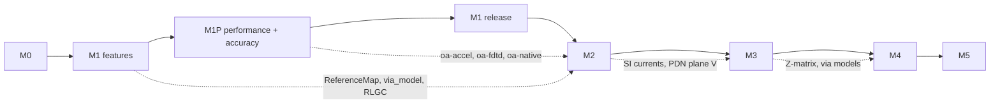

# Open_Analysis Roadmap

Status: v1, 2026-10-27. Each milestone has a scope, **exit criteria** (what must work end to end), and **validation gates** (numerical acceptance that CI enforces through golden tests). A milestone closes only when every gate is green on the CI matrix (Windows, Linux, macOS for the core; external-solver gates nightly). Work packages per milestone are in [TASKS.md](TASKS.md).

Tolerance tiers, used throughout:
- **T0 analytic**: ≤ 0.5 % (impedance), ≤ 0.1 % (DC resistance), ≤ 1 % (resonance frequencies).
- **T1 published**: ≤ 1-3 % against literature or vendor tables (each case cites its source).
- **T2 cross-solver**: ≤ 2-5 % between independent solvers.
- **T3 measured**: within the stated measurement uncertainty, which is documented per case.

---

## M0: Scaffold, frozen model, fixtures (Wave 0)

Scope:
- The uv workspace with all package skeletons, import-linter layering, CI (lint, types, tests, license audit, schema compatibility), SPDX/REUSE setup, the docs site skeleton, and the ADRs.
- `oa-model` implemented completely to board-model.md: schemas exported and the v1.0 freeze declared.
- The interface types marked *(W0)* in interfaces.md: CrossSection, EMProblem, QS/Thermal reserved types, result containers, plugin protocols, the job protocol and the registry.
- `oa-testkit`: synthetic `Board` builders for the seven reference structures, CrossSection and EMProblem fixtures, the golden harness, and pytest markers.

Exit criteria:
- `uv sync && uv run pytest` passes on all three OSes.
- `uv run lint-imports` passes, and a deliberately illegal import in a test fixture package fails it.
- `schemas/*.json` are committed. A CI check regenerates them and diffs.
- Every fixture board passes `validate_board(strict=True)` and round-trips through `.oab.json` and `.oab` with identical `content_hash()`.

Validation gates:
- Property tests (hypothesis) cover the `Points`/`Polygon` invariants (orientation and immutability) and `parse_quantity`.
- CrossSection keys are stable to 1 nm rounding, and they change when any geometric value moves by 2 nm.

---

## M1: MVP, "SI9000 + HyperLynx DRC + DC IR + openEMS/Palace for KiCad"

M1 is delivered in two steps. **M1 features** (Waves 1-3, below) build the functionality. The **M1 release** (WP-303) ships it, and only after **M1P** (the next section) has passed its benchmark gates. The project owner decided this on 2026-10-29.

Scope:
1. **Ingest.**
   - Own `.kicad_pcb` + `.kicad_pro` reader (KiCad 7 to 10 formats).
   - IPC-2581 reader.
   - Altium and others through `kicad-cli pcb import`.
   - Optional pcbnew zone refill.
   - `oa ingest`, `oa doctor`.
2. **Physics.**
   - Material library.
   - Djordjevic-Sarkar and table dielectrics.
   - Hammerstad, Groisse and (Cannonball-)Huray roughness.
   - Etch.
   - ρ(T).
   - Analytic via R/L/C estimators.
3. **Impedance.**
   - The closed-form set (HJ + KJ, Wheeler, Cohn + Wheeler, CPW/CPWG, coupled lines, IPC legacy).
   - 2D **BEM** with RLGC(f), modal and mixed-mode values.
   - 2D **FEM reference** (scikit-fem + gmsh), electrostatic plus eddy-current R(f)/L_int(f).
   - The per-net **impedance profile** along routed traces.
4. **ERC/EMI.**
   - The rule engine.
   - The M1 rule set in interfaces.md §3.6: RP-001/002/003/004/007, ED-001/002/003, IM-001/002/003/005, DP-001/002/003, VI-001/002, XT-001, PD-001, RF-001, EM-011. This covers EMI E1–E6 and E11.
   - The shared `ReferenceMap`.
   - Waivers.
   - SARIF output and `--fail-on` for CI.
5. **DC IR drop.**
   - One rail plus its return.
   - Pin-group loads, VRM with remote sense, via-barrel resistors.
   - Voltage and current-density maps, via/load tables.
   - Raster reference solver.
6. **3D full-wave S-parameters.**
   - Region cut-out, the EMProblem builder, and automatic trace-end and lumped ports.
   - **openEMS adapter** (local, Windows-native).
   - **Palace adapter** (WSL/Docker/Linux).
   - Touchstone output with the **quality gate**.
   - Reference-plane de-embedding.
7. **Platform.**
   - The job system (SQLite, process pool, cache, local/WSL/Docker runners).
   - The FastAPI server.
   - The web UI: board view, stackup view, setup forms, job panel, result viewers for every M1 result type, and a 3D region preview.
   - The `oa` CLI for every analysis, with the agent conventions: `--json` envelope, documented exit codes, no prompts, `oa describe`/`oa schema`.
   - **AI agents as first-class users** (ADR-0007, [specs/ai-integration.md](specs/ai-integration.md)):
     - the `oa-mcp` MCP server (stdio + streamable HTTP) over the shared `oa-service` command catalog;
     - result summaries, accuracy classes and violation remediation;
     - read-only by default, with propose → apply for `.kicad_dru` and net-class changes;
     - compute budgets;
     - `llms.txt`, `docs/agents/AGENTS.md` and `CLAUDE.md`.

Exit criteria (end to end, on the WP-102 synthetic boards and two real open boards: the KiCad 10 demo `cm5_minima` and one 6- to 10-layer open-hardware board):
- `oa ingest` reads every board in under 10 s (88 MB Jetson demo: under 30 s) with no errors.
- The KiCad reader and the IPC-2581 reader agree on net count, via count, per-net copper area (≤ 0.5 %) and stackup z (≤ 1 µm). This is WP-208.
- `oa erc --sarif` produces exactly the expected violations on every synthetic rule board: no misses and no extras.
- `oa impedance profile` on the diff-pair and CPWG boards produces profiles within gates. `oa pi dc` on the power-plane board meets the gates.
- `oa em --solver openems` and `--solver palace` produce a quality-gated `.s2p`/`.s4p` for the via-transition board. The two solvers agree within the T2 gate.
- The web UI shows all of the above. Playwright smoke tests pass.
- The published validation page `docs/validation/` is generated from the golden results.
- **AI agents.** An AI agent, via MCP, runs the M1 workflow end to end in an automated test (`tests/agents/test_m1_workflow.py`, WP-210/WP-303). The test runs on Windows and Linux with no network beyond loopback, and covers:
  1. load a board;
  2. impedance profile;
  3. ERC;
  4. DC IR;
  5. read results.

  It passes when:
  - every step returns a valid envelope;
  - every result summary is within its size cap and states its accuracy class;
  - every violation carries a remediation;
  - the data equals the corresponding `oa ... --json` output;
  - no file outside `.oa/` is modified.

Validation gates:

| Area | Case | Gate |
|---|---|---|
| Closed form | HJ table (report 02 §4.3), Cohn stripline W/b=0.1…2.0, coupled stripline (Z0e, Z0o) table, CPW S=1 G=0.5 (120.57 Ω er=1; 51.88 Ω er=9.8) | 1e-6 relative (implementation lock) |
| Closed form vs scikit-rf MLine/CPW | 20 random in-range cases | ≤ 0.1 % |
| IPC legacy | h=0.2 mm, t=35 µm, er=4.3, W=0.5 mm: IPC 36.8 Ω vs Wheeler 41.1 Ω | reproduce both to 0.1 Ω |
| BEM/FEM analytic | coax ln(b/a)=1 air → 59.958 Ω; wire over plane acosh; two-wire; zero-t stripline (Cohn) via t→0 extrapolation | T0 (≤ 0.5 %; BEM ≤ 0.1 % on coax) |
| BEM self-checks | homogeneous medium L·C = μ0ε0εr·I; C symmetric; mirror symmetry | ≤ 1e-6 relative |
| BEM vs FEM | 50 PCB structures (surface/coated/embedded microstrip, symmetric/offset stripline, CPWG, edge-coupled MS/SL, broadside) | Z0 ≤ 0.5 %, Zdiff ≤ 1 % |
| BEM vs published | ≥ 10 Polar SI9000 app-note structures (AP131 etc.), Wadell worked examples | single-ended ≤ 1 %, differential ≤ 2 % |
| Loss | round-wire R(f) vs Bessel solution; DS fit round-trip; Huray K(f) vs published curve | ≤ 2 % over 1 MHz-50 GHz |
| Convergence | FEM refinement, Richardson-extrapolated error | < 0.1 % on finest; monotone |
| ERC | one synthetic board per rule (positive + negative), plus a combined board | exact match of rule id, net, layer; location within 50 µm |
| DC IR analytic | strip R = Rs·L/W; annulus Rs·ln(b/a)/2π; two layers + N vias; via R (0.30 mm drill, 25 µm plating, 1.6 mm → 1.27 mΩ) | ≤ 0.1 % (strip/annulus), ≤ 0.5 % (vias) |
| DC IR cross-check | FEM vs in-repo raster FVM on the power-plane board; kicad-irdrop 4-layer board (published 3.04 mΩ; padne 2.97 mΩ) | ≤ 1 % FEM vs raster at h/4; ≤ 3 % vs kicad-irdrop |
| DC convergence | point-contact disk under refinement | documented order; mesh-independent within 0.5 % with ring contacts |
| EM sanity | microstrip and stripline thru (openEMS + Palace): Z0 from port impedance vs our 2D BEM; |S21| loss vs RLGC model | Z0 ≤ 3 %; IL ≤ 0.2 dB at 10 GHz per 25 mm |
| EM published | openEMS MSL notch filter tutorial; simple 2.4 GHz patch tutorial reproduced from our pipeline vs hand-written tutorial script | notch f ≤ 1 %; S11 min f ≤ 1 % |
| EM cross-solver | via transition 0-40 GHz, openEMS vs Palace | |ΔS21| ≤ 0.5 dB to 20 GHz, ≤ 1 dB to 40 GHz; |ΔS11| ≤ 3 dB where S11 > -30 dB |
| Quality gate | synthetic non-passive / non-causal / no-DC Touchstone fixtures | gate verdicts exactly as specified; real solver outputs PQM ≥ 99 |
| Via estimates | Goldfarb-Pucel barrel L, stub resonance (1.5 mm stub, Dk 4 → ≈ 25 GHz) | formula lock 1e-9 |

---

## M1P: Performance and accuracy (between M1 features and the M1 release)

Goal: results as good as or better than the commercial incumbents (HFSS/SIwave/Q3D, HyperLynx, Polar SI9000, Sonnet), with openEMS and Palace as the open baselines, on the user's own hardware, using an NVIDIA or AMD GPU when present. The benchmark targets in [BENCHMARKS.md](BENCHMARKS.md) gate everything, including the M1 release. Design: [ADR-0009](adr/0009-gpu-acceleration.md) (GPU backend `oa-accel`), [ADR-0010](adr/0010-gpu-fdtd-engine.md) (own GPU FDTD engine `oa-fdtd`), [ADR-0008](adr/0008-compiled-core.md) (compiled core, pulled forward into M1P). Work packages: WP-304 and WP-501 to WP-511 in [TASKS.md](TASKS.md).

Scope:
1. **Benchmark harness** (WP-304): runs the BENCHMARKS.md cases and records accuracy, time and memory per backend. It publishes them on the validation page with history and regression alerts.
2. **Palace production** (WP-501, WP-502):
   - converged p2/p3 + AMR configuration and iterative solvers;
   - adaptive fast sweep and per-band dielectrics;
   - surface-impedance copper with roughness;
   - root cause and fix of the 0.5 dB openEMS-vs-Palace microstrip discrepancy;
   - a CUDA build in WSL2, and a documented HIP path.
3. **Own GPU FDTD engine** `oa-fdtd` (WP-505, WP-506, WP-507):
   - graded Yee grid, thick-copper SIBC, conformal vias, CPML, multi-pole ADE dielectrics;
   - lumped and quasi-TEM mode ports, multi-port batching;
   - CuPy kernels with a NumPy oracle;
   - registered as the `fdtd` adapter.
4. **GPU backend** `oa-accel` (WP-503, WP-504): CuPy single source with a CPU fallback, covering BEM dense solves, DC IR/thermal sparse solves and raster solvers. It replaces the WP-413 sketch.
5. **Compiled core** `oa-native` (WP-508, WP-509): Rust/PyO3 for the KiCad parser, ReferenceMap, ERC loops and BEM assembly, each with its Python oracle. This is WP-414, pulled forward.
6. **Accuracy closure** (WP-510):
   - the BEM dielectric-interface εeff gap and CPW truncation;
   - openEMS adapter multi-pole Debye, thick copper and the stripline stall;
   - published-reference slots filled from checked sources.
7. **Gate run** (WP-511): the full benchmark run on the reference machine and a signed-off report.

Exit criteria:
- Every **gating** case in BENCHMARKS.md §2 has status `pass` on the reference machine under the `bench` profile: B-IMP-01…04, B-DC-01…02, B-ERC-01, B-ING-01, B-EM-01…06, B-PERF-01. Cases whose only reference is `[verify]` do not gate. A case may gate on its converged reference alone.
- For each B-EM case, at least two solvers meet the accuracy gate against the reference: oa-fdtd plus Palace, or plus openEMS. oa-fdtd meets the GPU runtime gate on B-EM-01…05.
- The GPU and CPU backends agree within the ADR-0009 §5 tolerance classes on every case they both run. Each case passes with `OA_DEVICE=cpu` on a machine without a GPU (accuracy gates; runtime is reported only).
- No benchmark run exceeds its memory ceiling, and the harness's host cap is never hit. There is no machine freeze during the gate run.
- The benchmark page is generated from `tests/benchmarks/results/*.json` and published with `docs/validation/`. History shows no regression above 20 % against the M1P baseline.
- The native (Rust) paths produce results identical to their Python oracles (B-ERC-01, B-ING-01). Prebuilt wheels build in CI for Windows, Linux and macOS.

Validation gates: the accuracy columns of BENCHMARKS.md §2 are the gates. They tighten the M1 gates where they overlap:
- EM thru IL: 0.2 dB becomes 0.05 dB;
- BEM vs exact: 0.1-0.5 % becomes 0.05 %;
- the openEMS-vs-Palace via transition: 0.5 dB becomes 0.1 dB to 20 GHz against the converged reference.

---

## M2: Signal integrity (linear), AC PDN (lumped), thermal, Q3D-lite, EMI estimates, KiCad live link

Scope:
- **SI (linear):**
  - Net topology to channel (MTL ABCD from RLGC, analytic via π model, pads as lumped elements).
  - Node-equation S-parameter cascade; IL/RL/TDR; step and pulse responses via IFFT.
  - Delay, flight time and skew reports, with field-solved delays exported to KiCad 10 tuning profiles.
  - Batch net screening with behavioural drivers.
  - Mixed-mode SDD/SCD.
- **Crosstalk scan:** coupled-section finder, N-conductor cross-sections, Kb/Kf screening, NEXT/FEXT/PSXT. Rules XT-002/003.
- **AC PDN (lumped):**
  - Target-impedance calculator with masks.
  - Capacitor library with DC-bias derating, plus Touchstone/SPICE import.
  - VRM model, mounting and spreading inductance.
  - Z(f) per load, board crossover.
  - Analytic rectangular cavity Z_ij.
- **DC IR production:** multi-rail power tree, series elements, current-density/via limits, corner runs.
- **Thermal:** layered FVM, component sources (uniform and two-resistor θJC/θJB), convection and radiation BCs, **electro-thermal Picard loop with DC IR**, and runaway detection.
- **Quasi-static 3D (Q3D-lite):**
  - FasterCap (C) and FastHenry2 (R(f), L(f)) adapters for vias, via arrays, connector footprints and decap mounting loops.
  - Palace electrostatic/magnetostatic reference.
  - π-section SPICE export with passivity and `validity_fmax`.
- **EMI:** rules EM-007/009/010/012/013 plus the remaining P2 ERC rules. Closed-form DM/CM radiated estimates per net with FCC/CISPR overlays. openEMS NF2FF far field (gain, efficiency) for antennas.
- **Platform:**
  - KiCad IPC plugin (thin): snapshot the board, open the UI, cross-probe and highlight.
  - Static HTML reports.
  - The `ssh-slurm` runner design (implementation M3).
  - Optional in-app AI assistant (`oa-assistant`, WP-411): off by default, BYO key, Claude reference provider over the same MCP/catalog tools, documented data disclosure.

Exit criteria:
- On a PCIe-like diff channel board, `oa si channel` gives SDD21/SDD11/TDR, and an IL report matches openEMS on the full channel cut within the gates.
- On a 4-layer FPGA-rail board, the PDN Z(f) shows the target crossover. Electro-thermal DC IR converges and reports ΔT.
- A via-array extraction exports a SPICE subcircuit that ngspice simulates, and the result matches the openEMS S-params up to `validity_fmax`.
- The KiCad plugin round-trip works on Windows and Linux.

Validation gates:
- **SI:**
  - Lossless reflection lattice; quarter-wave stub notch; matched/mismatched terminations against analytic results.
  - Cascade vs scikit-rf and SignalIntegrity (an oracle subprocess) to 0.1 dB up to Nyquist, delay ≤ 1 %.
  - Kb/Kf vs closed forms ≤ 3 %.
  - Debye Kramers-Kronig residual < 1e-3.
- **PDN:**
  - Single cap SRF/ESR exact; N parallel caps Z/N.
  - Lumped ladder vs an ngspice netlist ≤ 0.1 %.
  - Analytic cavity resonances vs eigen ≤ 1 %.
  - Smith 1999 bank example reproduced.
- **Thermal:**
  - Slab, fin (λ = √(kt/2h)) and spreading resistance (Lee 1995) ≤ 1 %.
  - IPC-2152 10 °C curves within chart scatter (±20 %).
  - JEDEC 2s2p θJA trend and rank order against the TI SPRA953 / Richtek AN044 tables (±25 % absolute).
- **Quasi-static:**
  - Parallel plates and two spheres C ≤ 2 %; Palace rings mutual L ≤ 2 %.
  - Round-wire R(f) ~ √f trend and Bessel ≤ 3 %.
  - Via barrel L vs Goldfarb-Pucel ≤ 10 % and vs Palace ≤ 3 %.
  - The via π model vs openEMS agrees up to c/(10·h·√εr).
- **EMI:**
  - Hertzian and half-wave dipole far field ≤ 0.5 dB.
  - DM/CM closed forms implementation-locked to Ott/Paul.
  - openEMS patch NF2FF gain within 0.5-1 dB of the published design.
  - EMI rule boards exact.

---

## M3: Field-solved PDN, IBIS transient, generalized extraction, field-based EMI, scale-out

Scope:
- **AC PDN field-solved:** a 2D Helmholtz FEM per cavity on the DC mesh, multi-cavity via coupling, port reduction to a Z-matrix (10 kHz-1 GHz), resonance eigenmodes and maps, transfer impedance, and PDN Touchstone export.
- **SI nonlinear:**
  - IBIS parsing (PyAMI/ecdtools), with `ibischk` when present.
  - libngspice transient with TXL/CPL and vector-fitted S-blocks.
  - Overshoot, ringback and settling; DDR4 fly-by checks.
  - Physics-based via model with backdrill what-if.
  - 3D-extracted Touchstone cascading (de-embedded, rational-fitted).
- **Generalized 3D extraction regions:** connectors, plane necks, decap mounting loops fed into PDN; frequency-dependent RL fitting with passivity.
- **EMI field-based:** TL-current dipole sum with images; cavity edge radiation from PDN plane voltages; per-net emission reports at 3 m/10 m.
- **Thermal:** Elmer 3D reference mode (`fem3d`), heatsink and fixed-T regions.
- **Solvers:** EMerge adapter (optional Windows-native FEM), Palace eigenmode, AMR-driven convergence studies, automatic convergence reports.
- **Scale:** `ssh-slurm` and cloud-batch runners; farming openEMS and oa-fdtd excitations and sweeps across nodes; multi-GPU oa-fdtd. The Rust (PyO3) core and GPU backend themselves moved into M1P (ADR-0008, ADR-0009).
- Remaining P3 rules: IM-007, VI-003, VI-004, PD-004.
- **ML surrogate (WP-412):** `oa-xsdataset/1` export of cross-section → RLGC pairs, and an optional domain-gated impedance surrogate behind the impedance service that always reports `accuracy_class="surrogate"`.

Exit criteria:
- PDN Z(f) on the Samtec/IEEE EPS TC-EDMS benchmark board (imported through IPC-2581) is compared with the published measurements.
- A DDR4 byte-lane IBIS transient report runs on an open board.
- A 3D extraction region feeds the PDN model and changes the predicted Z(f) consistently with openEMS.

Validation gates:
- FEM Helmholtz vs analytic cavity Z11/Z21 at several ports, resonances ≤ 1 %.
- PDN vs the TC-EDMS measurements: |Z| within ±20 % from 100 kHz to 200 MHz, with documented deviations.
- IBIS transient vs ngspice reference netlists ≤ 1 % on waveform RMS.
- The TL-dipole microstrip radiation vs openEMS NF2FF within ±3 dB, and the DM trend against Leone 2003 / Hockanson 1996.
- Layered FVM vs Elmer 3D peak ΔT ≤ 5 %.
- openEMS vs Palace on a 10 GHz hairpin filter: passband IL ≤ 0.3 dB, f_center ≤ 1 %.

---

## M4: SerDes compliance, SYZ hybrid extraction, optimization (HyperLynx SI/PI parity)

Scope:
- Pulse response, PDA and statistical eye with BER contours.
- Reference FFE/CTLE/DFE equalizers.
- IBIS-AMI through PyAMI/PyBERT in a sandbox process.
- A **COM** (IEEE 802.3) reimplementation.
- ILD/ICR/PSXT, plus user-supplied compliance mask files (no copyrighted tables shipped).
- The **DDR wizard** (DDR4 first, then DDR5/LPDDR): byte-lane grouping, timing budgets, eye masks.
- **SYZ hybrid extraction** (SIwave-class) of arbitrary board regions, from 2D TL plus cavity planes plus physics-based vias, stitched and causal.
- **Decap optimizer** (greedy + prune, then GA) on the reduced Z-matrix, with sensitivity ranking. Time-domain PDN droop.
- An in-house **PEEC** for inductance/resistance and current density, which feeds EMI.
- NF2FF on full-wave runs with a semi-anechoic chamber two-ray model and height scan.
- Chip-package-board co-simulation netlisting with IBIS package / IBIS-ISM.
- Monte Carlo and corner sweeps (etch, Dk, thickness).

Exit criteria:
- COM on public IEEE 802.3ck/dj channels.
- PCIe-style channel IL/RL/eye with user masks.
- SYZ on the TC-EDMS board compared with full-wave and measurement.
- A decap optimizer run meets a target mask at lower BOM count than a baseline.

Validation gates:
- COM within 0.1 dB of the IEEE MATLAB reference on ≥ 5 public channels.
- Statistical eye vs PyBERT within 2 % eye height.
- SYZ vs Palace full-wave on a 4-port plane-pair region: |ΔZ| ≤ 10 % to 2 GHz.
- PEEC vs FastHenry2 ≤ 2 % on via arrays.

---

## M5: SIwave/HFSS/Q3D/HyperLynx parity and sign-off hardening

Scope:
- Full-board hybrid SI/PI (SIwave-class) with automatic hot-spot hand-off to full wave.
- Transient thermal.
- Optional CFD (OpenFOAM CHT) for enclosures.
- Immunity and BCI (field-to-line coupling).
- ESD path checks.
- An ODB++ reader.
- Optionally, a native Altium `.PcbDoc` reader, only if the kicad-cli path proves insufficient.
- Near-field scan import and comparison.
- A planar 2.5D MoM solver, research track, possibly in collaboration (report 05 §1.2).
- Sign-off workflows: frozen solver images, reproducibility manifests, signed reports.
- Cloud execution.
- A measured validation coupon program, community-contributed and VNA-measured, published.

Exit criteria:
- A published validation report comparing Open_Analysis against commercial tool results on at least five public boards (provided by users with licences) across SI, PI, EM, thermal and EMI.
- Every remaining gap is tracked as an issue with a parity rationale.

Validation gates:
- The measured coupon program results (T3) are within the documented uncertainty for IL, RL, NEXT and FEXT, TDR, PDN Z, and temperature rise.

---

## Milestone dependency summary

