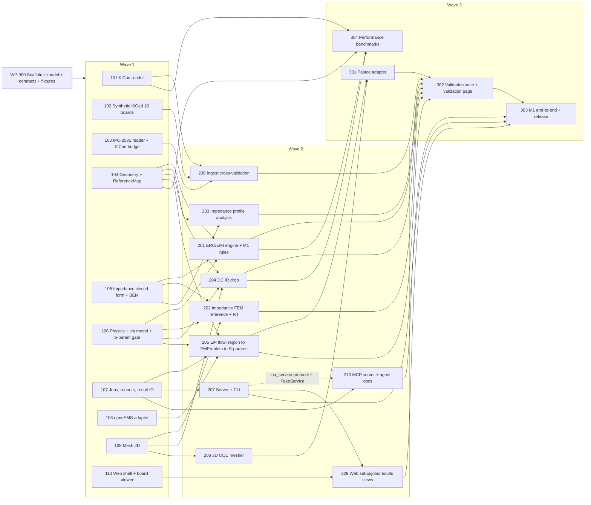

# Work Breakdown for Parallel Implementation

Status: v1, 2026-10-27 (AI integration added per ADR-0007). This file covers M0 and M1 in full detail and sketches M2 at the end. Contracts: [specs/board-model.md](specs/board-model.md), [specs/interfaces.md](specs/interfaces.md), [specs/ai-integration.md](specs/ai-integration.md). Architecture: [ARCHITECTURE.md](ARCHITECTURE.md). Gates: [ROADMAP.md](ROADMAP.md).

## Rules of engagement (every agent reads this first)

1. **Owned directories are exclusive.** Within a wave, no two WPs own overlapping paths. Write only inside your owned paths. Reading is unrestricted.
2. **Shared root files.**
   - `pyproject.toml` (root), `uv.lock` and `.github/workflows/ci.yml` belong to WP-000 and, after it, to the integrator.
   - You add dependencies only to *your package's* `pyproject.toml`. The integrator re-runs `uv lock` at merge. Never commit `uv.lock` changes from a WP branch.
   - Extra CI for your area goes in your own workflow file `.github/workflows/<wp-id>.yml`.
3. **Contracts are frozen.** If a contract in `docs/specs/` blocks you:
   - Write `docs/change-requests/<WP-ID>-<slug>.md` describing the problem, the proposed change and the impact. That file is always yours.
   - Implement a local adapter, and do not edit the spec.
   - The architecture owner decides, and if needed issues an ADR.
4. **Use the test harness.** Use `oa_testkit` fixtures and `oa_testkit.harness.run_inline()` instead of depending on unfinished packages. Wave-1 analyses must not need `oa_jobs` to test.
5. **Golden data.** Each WP owns `tests/golden/<suite>/` for the suites named in its acceptance criteria. Every case has a `case.toml` with `source` (citation or "analytic: <formula>"), `tolerance`, `inputs` and `expected`. Regenerate only with `--update-golden`, and list regenerated files in the PR description.
6. **Definition of done.**
   - All acceptance tests pass on Windows and Linux. macOS passes for the pure-Python packages.
   - `ruff`, `mypy` (strict where required) and `lint-imports` are clean.
   - A package README states the public API, the contracts implemented and the golden suites.
   - Every new source file has an SPDX header.
   - There are no `TODO`s in public APIs.
7. **AI and agent contracts** (ADR-0007, [specs/ai-integration.md](specs/ai-integration.md); §13 there is a binding addendum to interfaces.md):
   - Every public model field has a `description` with its unit in `[...]` (ai-integration §7.1).
   - Errors are `ErrorInfo{code, message, path, hint}` (§6). Never raise bare exceptions across a package boundary.
   - Every `ResultItem` you produce sets `accuracy` (§4.1). Every payload's `summary()` stays within the size caps (§4.2).
   - Every violation sets `remediation` and `measured`/`limit`/`unit` for threshold rules (§5).
   - User-level operations are `oa_service` commands. CLI, REST and MCP code contains no logic of its own.
   - Read-only by default. Only `write` commands touch user files, through propose → apply (§10.3).
   - No network and no LLM calls outside `oa-assistant`. Import-linter and a socket guard enforce this.
   - Output ordering is deterministic (§3.3, §3.5).
8. **Sizes** (one agent, focused):
   - S ≤ 2 days.
   - M 3-5 days.
   - L 6-10 days.
   - XL > 10 days (split it if possible).

8. **Test helper modules need unique names.** Tests run under `--import-mode=importlib`, with each package's `tests/` directory on `sys.path`. A non-test module in `tests/` therefore shares one global namespace with every other package's test helpers. Name helpers with a package prefix, such as `geometry_helpers.py`, and never `from conftest import ...`.

9. **Keep iteration cheap.**
   - While iterating, run only your own package's tests with `uv run pytest packages/<pkg> -q`, plus `ruff`/`mypy` on your paths.
   - Run the full CI command set once, before reporting done: `ruff check`, `ruff format --check`, `mypy`, `lint-imports`, and `pytest -m "not external and not kicad"`.
   - Read only the spec sections your brief names. Look up other sections only when you hit a specific question.

---

## Dependency graph

Critical path: WP-000 → WP-104 → WP-205 → WP-301 → WP-302 → WP-303.

---

## Wave 0 (one agent)

### WP-000 Scaffold, frozen model, contracts, fixtures. Size: L (≈ 8-10 days)
**Owned:**
- `pyproject.toml`, `uv.lock`, `.github/workflows/ci.yml`, `.pre-commit-config.yaml`, `LICENSE`, `LICENSES/`, `REUSE.toml`;
- `packages/*/pyproject.toml` (skeletons for **all** packages in interfaces.md §0, including reserved names);
- `packages/oa-model/**`, `packages/oa-results/**` (types only; `src/oa_results/io/` is left as an empty package for WP-107);
- `packages/oa-framework/**`, `packages/oa-testkit/**`;
- `schemas/**`, `tests/fixtures/**`, `docs/adr/**` (already present), `mkdocs.yml`.

**Inputs:** this repository's docs.

**Deliverables:**
1. **Workspace.**
   - A uv workspace with every package skeleton (`src/<name>/__init__.py`, `py.typed`, `tests/`).
   - Expected third-party dependencies pre-declared per package (list in ARCHITECTURE.md §2 and §6) to minimize later lock churn.
   - Ruff, mypy and pytest config.
   - Import-linter `layers` + `independence` contracts exactly as interfaces.md §0.
   - REUSE/SPDX setup.
   - CI on {windows, ubuntu, macos} × {3.11, 3.13} with lint, types, tests, lint-imports, `reuse lint`, `pip-licenses` against an allow-list, and a `schema-compat` check.
2. **`oa_model`**, complete per board-model.md:
   - all models and `Points`/`Floats`/`NDArray`;
   - units and `parse_quantity`;
   - `validate_board` with every listed code;
   - `BoardIndex`;
   - `apply_physics`, `resolve_intent`;
   - setup schemas (ports, intent, `ProjectManifest`, `AnalysisSetup`);
   - `xsection` (CrossSection + `canonicalize` + `key`);
   - `em` (Structure3D, EMProblem and so on); `qs` and `thermal` reserved types;
   - load/dump `.oab.json` and `.oab`, migrations scaffold, newer-minor pruning;
   - the material library `data/materials.yaml` (≥ 8 entries with citations: generic FR-4, a 370HR-class laminate, Megtron-6-class, Rogers 4350B-class, PTFE, LPI solder mask, copper ED, copper rolled).
3. **`oa_results`** types (interfaces.md §1.1, §3.7, §4.1). **`oa_framework`**: protocols, `Registry` (entry points and `for_tests`), `Services`, the `JobService` protocol, `ExternalCommand`/`ExternalRunner` types, errors.
4. **`oa_testkit`.**
   - Builders: `microstrip_board`, `stripline_board`, `diff_pair_board`, `cpwg_board`, `split_plane_board`, `via_transition_board`, `power_plane_board`, each parameterized and each returning `Board`.
   - CrossSection fixtures: the HJ table cases, Cohn stripline cases, edge-coupled stripline, CPW S=1/G=0.5, coax ln(b/a)=1, wire over plane, two-wire line.
   - EMProblem fixtures: a 25 mm microstrip thru with 2 lumped ports, a 25 mm stripline thru with 2 wave ports, a single via transition with 2 wave ports.
   - `golden.assert_close_to_golden`, the `--update-golden` option, markers (`golden`, `external`, `slow`, `kicad`), and `harness.run_inline(analysis, board, setup, registry)` (plan → run_task → reduce with an in-memory RunContext).
5. `schemas/board-model.v1.json`, `oa-physics.v1.json`, `oa-intent.v1.json`, `oa-setup.v1.json`, `oa-xsection.v1.json`, `oa-emproblem.v1.json`, `oa-result.v1.json` plus `schemas/CHANGELOG.md`. The fixture dumps go in `tests/fixtures/model/*.oab.json`.

**Acceptance:**
- `uv sync && uv run pytest` passes on the CI matrix. `lint-imports` passes. A test proves a forbidden import (`oa_erc` → `oa_pi`) is caught, using a throwaway contract on a temp package.
- Round trip: for every builder, `load_board(dump_board(b)) == b`, and `content_hash` is identical across `.oab.json`/`.oab` and across Windows/Linux (a CI artifact comparison).
- `validate_board(strict=True)` passes for every builder. Each `MODEL.*` code has a negative test that triggers it.
- Hypothesis tests: `Polygon` orientation normalization helper, `Points` immutability, `parse_quantity` (≥ 30 examples, including `5mil` = 1.27e-4, `1oz` rejected for length, `25degC` = 298.15).
- `CrossSection.key()`: invariant under translation and provenance changes, changes under a 2 nm move, stable under 0.4 nm jitter.
- `apply_physics` on the microstrip builder with the example sidecar in board-model.md §11 gives the documented layers. `ConstantDkDf` is upgraded to DS.
- `harness.run_inline` runs a dummy analysis (in the testkit's tests) with 3 tasks and a reduce.
- Freeze declaration: `docs/specs/board-model.md` header changed to "FROZEN v1.0 (commit <sha>)".

**AI addendum (ADR-0007; ai-integration.md §13 items A1-A10, A13):**
- 000B:
  - `ErrorInfo`, plus `OAError.path/hint/details/info()`.
  - `SetupError`/`BoardValidationError.issues`, mapped from pydantic errors with JSON-Pointer paths.
  - `Diagnostic.path/hint`.
  - A field `description` with units on every `oa_model` field.
- 000A:
  - `Accuracy`, plus `ResultItem.accuracy`.
  - `ResultSummary`/`BundleSummary`, plus `summary()` on every payload type and `ResultBundle.digest()`.
  - The `Provenance` additions.
  - `Remediation`, plus `Violation.remediation`, with a validator filling `fix_hint`.
  - `Budget`, `PlanEstimate`, `AnalysisRequest.budget`, `JobStatus.cancel_reason`, `JobService.estimate`.
  - The `"surrogate"` method literal.
  - The new entry-point group names.
- Acceptance:
  - Every committed fixture bundle (one per payload kind) yields a `ResultSummary` ≤ 2 KiB and a `BundleSummary` ≤ 8 KiB.
  - `ResultBundle.summary == digest().text`.
  - A pydantic `extra_forbidden` error on a setup becomes an `ErrorInfo` with `path="/config/<field>"` and a hint.
  - The JSON Schemas in `schemas/` have a `description` on every property, checked by a temporary local test until WP-210's lint lands.

---

## Wave 1 (10 parallel WPs, all depend only on WP-000)

### WP-101 KiCad native reader. Size: L
**Owned:** `packages/oa-ingest-kicad/**`, `tests/golden/ingest_kicad/**`

**Inputs:**
- WP-000 and board-model.md.
- docs/research/01-ingest.md (whole file).
- KiCad demos at `D:\Program Files\KiCad\10.0\share\kicad\demos` (read-only, for development).
- Hand-written S-expression snippets in your own tests.

**Deliverables:**
- A streaming S-expression tokenizer, with point lists parsed straight into numpy. It tolerates unknown tokens, which it logs as `INGEST.UNKNOWN_TOKEN` info diagnostics.
- A semantic reader `KiCadReader` (`Reader` protocol, entry point `kicad`) for format versions 20221018 (v7) to 2026xxxx (v10), with the version support table in the README.
- Coverage:
  - layers and stackup, including `addsublayer` flattening and mask;
  - nets in both forms (v9 table and v10 name-only);
  - net classes and patterns from `.kicad_pro`;
  - diff-pair heuristic;
  - tracks and 3-point arcs → `ArcSeg`;
  - vias (through/blind/buried/micro, padstack modes, backdrill secondary/tertiary, protection flags);
  - footprints and pads (relative position, **absolute rotation**, back-side, every pad shape, custom pads unioned, drill offset, slots, die_length/die_delay);
  - zones (fills re-unioned from fractured polygons, keepouts, teardrops, priority, fill_state);
  - graphic copper;
  - outline chaining (1 µm tolerance; `gr_line/arc/circle/rect/poly/curve`, plus footprint Edge.Cuts).
- Unit conversion (mm → m, Y flip). Stable ids (`k:<uuid>`).
- A pcbnew verification note in the README on backdrill end-layer semantics (board-model.md §8), confirmed by running KiCad's bundled Python.

**Acceptance:**
- Every board in `share/kicad/demos` (≥ 10 boards, including `cm5_minima` and `jetson-agx-thor-baseboard`) loads with no `error` diagnostics, and `validate_board(strict=True)` passes.
- Golden `ingest_kicad`:
  - For 3 demo boards, the net count, via count by kind, pad count, track count, total track length per layer and stackup z-table match values extracted by a pcbnew script (committed under `tools/` inside your package, run once with KiCad Python, outputs committed). Counts must be exact, lengths ≤ 1e-9 relative, z ≤ 1 nm.
  - The per-layer copper area of zone fills vs pcbnew `GetFilledArea` is ≤ 0.1 %.
- Unit tests: pad rotation on a back-side rotated footprint, arc centre from 3 points (≤ 1 nm), fractured polygon → polygon with N holes, v9 and v10 net forms giving identical Boards apart from `meta`.
- Performance: `jetson-agx-thor-baseboard` (88 MB) loads in < 30 s and < 4 GB RAM on the reference machine. Record the measured time in the README.

### WP-102 Synthetic KiCad 10 test boards. Size: M
**Owned:** `tests/boards/kicad10/**`, `tools/boardgen/**`

**Inputs:** WP-000 (builders as a parameter reference), research 01 §1 (syntax), KiCad 10.0.5 at `D:\Program Files\KiCad\10.0`.

**Deliverables:**
- `tools/boardgen/` is a Python generator that writes `.kicad_pcb` + `.kicad_pro` text directly. Stackups are written in the file, because SWIG cannot set the stackup.
- It then uses `kicad-cli` and KiCad's bundled Python (`D:\Program Files\KiCad\10.0\bin\python.exe`) to:
  - refill zones (pcbnew `ZONE_FILLER`) and save;
  - run `kicad-cli pcb drc --format json` and commit the report;
  - export IPC-2581 rev C (`*.ipc2581.xml`) and ODB++ zip;
  - render PNGs (`kicad-cli pcb render` / svg) for docs.
- Every board directory has `board.kicad_pcb`, `board.kicad_pro`, `board.ipc2581.xml`, `drc.json`, `expected.yaml` (schema below) and `README.md` (intent and the variant's purpose).
- Boards. All are KiCad 10 format, FR-4-like Dk 4.3/Df 0.02 unless stated, 35 µm copper, and a known stackup.
  1. `microstrip`: 4 layers (1.6 mm), with L1 50 Ω microstrip traces (3 widths: 0.25/0.35/0.5 mm, h=0.2 mm to L2 GND), each 50 mm long. Edge launch pads. One variant `microstrip_v9` written in KiCad 9 syntax (net table), with identical copper.
  2. `stripline`: 6 layers. A symmetric stripline on L3 between L2/L4 GND, and an offset stripline on L4 (L3 empty above and L5 GND below).
  3. `diff_pair`: 100 Ω edge-coupled microstrip on L1 and stripline on L3. Includes a 3 mm uncoupled breakout (DP-001), a 0.4 mm intra-pair length mismatch (DP-002), a gap variation section (DP-003), and a layer change through a via pair with GND return vias.
  4. `cpwg`: L1 CPWG (S=0.3 mm, G=0.15 mm, h=0.2 mm) with a GND pour and via fences. One fence has its pitch at λ/10 at 10 GHz (pass) and one at 3× that (RF-001 fail).
  5. `split_plane`: 4 layers, with L2 GND split by a 1 mm slot and an L1 trace crossing it (RP-001). Also: a trace running 0.1 mm from the L2 plane edge (ED-001), a trace 0.3 mm from the board edge (ED-002), an L1 segment over a region with no L2 copper (RP-007), an antipad-cluster "swiss cheese" (RP-002), and a reference change from GND to +3V3 along a route (RP-003).
  6. `via_transition`: 8 layers (≈ 2.0 mm). An L1→L6 single-ended through via with an L6→L8 stub, the same via backdrilled from the bottom to L7, a differential via pair with 4 return vias, and a transition **without** a return via (RP-004).
  7. `power_plane`: 4 layers. L2 GND plane, L3 +1V0 plane 40 × 30 mm. A VRM footprint (`U5`, 3 output pins) at one end, and a load `U1` with 16 power pins + 16 GND pins on a 1 mm grid at the other, with via arrays. One decap at 1.5 mm from U1 (PD-001 pass) and one at 12 mm (fail).
     - Variant `power_strip`: an L1 copper strip 50 × 5 mm with full-width end pads, for the analytic R = Rs·L/W.
     - Variant `power_two_layer_vias`: two 20 × 20 mm squares on L1/L4 joined by N = 9 vias of known drill/plating.
  8. `combined`: every rule violation above on one board, plus net classes `50ohm`/`90ohm`/`100ohm` and an Altium-style explicit diff pair naming (`USB_D+`/`USB_D-`).
- `expected.yaml` schema (documented in `tests/boards/kicad10/README.md`):
  - `counts` (nets, vias by kind, pads, tracks, zones);
  - `stackup` (z_top/z_bottom per layer in metres);
  - `copper_area` (per layer per net, m², computed by pcbnew after refill);
  - `geometry` (named dimensions such as W, h, S, G, slot width and stub length);
  - `erc` (a list of `{rule_id, nets, layer, location_mm, tolerance_mm}` that MUST be reported, and `must_not_report: [rule_ids]`);
  - `dc` (analytic resistances where defined, with formula text);
  - `em` (suggested port definitions and frequency range for EM tests).

**Acceptance:**
- Every board opens in KiCad 10.0.5 (`kicad-cli pcb drc` exits 0).
- DRC JSON has zero errors except the ones listed in `expected.yaml: intended_drc`.
- `kicad-cli pcb export ipc2581` succeeds.
- Regeneration is deterministic: running `tools/boardgen/build_all.py` twice yields byte-identical `.kicad_pcb` files (fixed uuids).
- `expected.yaml` validates against its schema (a JSON Schema in the same directory).
- Expectations are traceable: each ERC expectation names the generator function that created the violating feature.

### WP-103 IPC-2581 reader and KiCad bridge (kicad-cli, Altium import, pcbnew helper). Size: L
**Owned:** `packages/oa-ingest-ipc2581/**`, `packages/oa-kicad-bridge/**`, `tests/golden/ingest_ipc2581/**`

**Inputs:** WP-000, research 01 §2.4, §4, §5. KiCad 10.0.5 locally.

**Deliverables:**
- `Ipc2581Reader` (entry point `ipc2581`), using lxml iterparse. It covers rev B and C:
  - units;
  - stackup (thickness, `DIELECTRIC_CONSTANT`, `LOSS_TANGENT`, material names);
  - padstacks, holes, back-drill spans (if present);
  - per-layer features (lines, arcs, polygons, contours with cutouts);
  - nets (`Set`s), components and pins;
  - outline.
  It converts to `Board`, with `meta.source_tool="ipc2581"`.
- `oa_kicad_bridge`:
  - `KiCadTools` resolves `kicad-cli` and KiCad Python from `tools.toml`, auto-detecting `D:\Program Files\KiCad\*\bin` on Windows and `/usr/bin` on Linux.
  - Functions: `upgrade(path)`, `drc(path) -> DrcReport`, `export_ipc2581(path, out)`, `export_odb(path, out, check_zones=True)`, `import_foreign(path, fmt="auto") -> Path` (`kicad-cli pcb import`, with the JSON report parsed into `Diagnostic`s), and `refill_zones(path, out)`, which runs a helper script with KiCad's Python through a subprocess, refills via `ZONE_FILLER` and saves to `out`.
  - `AltiumReader` (entry point `altium`, extension `.PcbDoc`) = `import_foreign` followed by the KiCad reader. The bridge sits at L2 next to `oa_ingest_kicad`, so it must not import it (or `oa_framework`). It resolves the `kicad` reader at runtime through `importlib.metadata.entry_points(group="open_analysis.ingest")`.
  - `ReadOptions.refill_zones` is honoured by a pre-step in the bridge.

**Acceptance:**
- IPC-2581 exports of 3 KiCad demo boards: counts, stackup thickness/Dk/Df and per-layer copper area match values recorded from pcbnew (≤ 0.5 % area, exact counts).
- ≥ 1 IPC-2581 file *not* produced by KiCad parses without errors: the Samtec/IEEE EPS TC-EDMS benchmark (if license permits download into the test cache; otherwise a documented manual test) or a public Altium/Allegro example.
- `refill_zones` on a board with a deliberately emptied zone produces `fill_state="refilled_by_tool"` and an area within 0.01 % of a GUI refill (recorded once).
- `import_foreign` round-trips a public Altium example board (e.g. from the Altium/KiCad importer QA corpus, if licensed) to a valid `Board`. Tests are skipped with marker `kicad` when KiCad is absent.
- No `pcbnew` import ever happens in the calling process (a test asserts `"pcbnew" not in sys.modules`).

### WP-104 Geometry service and ReferenceMap. Size: XL (split internally: copper/index → topology → reference map → sampling → regions)
**Owned:** `packages/oa-geometry/**`, `tests/golden/geometry/**`

**Inputs:**
- WP-000 (builders, CrossSection types, Structure3D types).
- interfaces.md §2.
- research 02 §5.3 (segment slicing and reference detection), 06 §3, 07 §3.1, 05 §3.1-3.2.

**Deliverables:** Everything in interfaces.md §2:
- copper unions (tracks buffered with round caps, arcs tessellated to `arc_tol`, pads from parametric shapes and rotation, via pads per padstack layer, zone fills, shapes);
- voids;
- `LayerIndex` STRtrees;
- `NetTopology` (junctions, stubs, pad stubs, via edges);
- islands;
- `ReferenceMap` (per-segment spans with coverage, edge distance, distance; via transitions with nearest return vias and stitching caps);
- `segments`, `cross_section_at` (trapezoid from etch, conformal mask regions via polygon offset, coplanar copper within window, aggressors, planes truncated to actual copper extent), `sample_net` (events: width change, ref change, layer change, neckdown, plane edge, no reference);
- `cut_region` → `Structure3D` + `boundary_crossings`;
- `resolve_terminal`;
- via stub length helper (`via_stub(via, used_layers) -> length`).

**Acceptance (golden `geometry`):**
- On `microstrip_board(w=0.35mm, h=0.2mm)`, `cross_section_at` gives a CrossSection with `topology_hint="microstrip"`, the trapezoid width within 1 nm and the plane at the correct z. The key is equal for all samples along the straight trace.
- On `stripline_board`, the symmetric section is classified `stripline` and the offset one `offset_stripline`. Distances to both planes are exact to 1 nm.
- On `cpwg_board`, coplanar grounds are included as `ground` conductors with gap G (1 nm). `diff_pair_board` gives 2 signal conductors in P, N order.
- `split_plane_board`: `ReferenceMap` spans show coverage < 1 exactly over the slot interval (± 10 µm). The RP-007 segment has `below=None`.
- `via_transition_board`: the stub length for the non-backdrilled via equals the z-distance from L6 to L8 barrel end (1 nm). The backdrilled via's stub equals the remaining L6→L7 portion.
- `power_plane_board`: `islands("+1V0") == 1`. Removing the via array (a builder parameter) yields 2 islands.
- `cut_region` on `via_transition_board` with nets = signal: every copper polygon inside the bbox is present, antipads are preserved as holes (count equals the builder's), and `boundary_crossings` lists exactly 2 trace crossings.
- Hypothesis: copper union area equals the sum of disjoint primitive areas (≤ 1e-9 relative) for random non-overlapping tracks; union is idempotent.
- Performance: `BoardGeometry.build` + `reference_map()` on a 10k-track synthetic board takes < 10 s.

### WP-105 Impedance: closed forms and 2D BEM, `impedance` service and `impedance.xsection` analysis. Size: XL
**Owned:** `packages/oa-impedance/**` (except `src/oa_impedance/fem/`, `src/oa_impedance/profile/`, `tests/fem/` and `tests/profile/`, which are reserved for WP-202/WP-203), `tests/golden/impedance_closedform/**`, `tests/golden/impedance_bem/**`

**Inputs:** WP-000 (CrossSection fixtures), research 02 (whole file). `oa_physics` is **not yet available**: use the `oa_physics` API from interfaces.md §10 through a thin local shim behind an interface, and swap to the real package when WP-106 merges. Keep the shim in `oa_impedance/_physics_compat.py`.

**Deliverables:**
- Closed forms (validity flags on every function):
  - HJ 1980 + thickness, Wheeler 1977, KJ 1982 dispersion, Jansen-Kirschning 1983 Z0(f);
  - embedded microstrip cover correction (flagged approximate);
  - Cohn stripline + Wheeler 1978 thickness, offset stripline (parallel approximation);
  - CPW and CPWG (Ghione-Naldi / Simons + Gupta thickness), using `scipy.special.ellipk` (m = k²) with Hilberg as a cross-check;
  - edge-coupled microstrip (KJ 1984 + 1985 errata), edge-coupled stripline (Cohn 1955 + Wadell t), broadside (Cohn 1960);
  - IPC-2141 legacy;
  - Wheeler-rule conductor loss.

  Porting KiCad `pcb_calculator/transline` or Qucs code is allowed (ADR-0001), with attribution.
- 2D BEM:
  - linear panels with corner grading and analytic log integrals;
  - free-charge plus polarization-charge formulation with dielectric interfaces truncated at `20·b` (configurable, reported in `notes`);
  - complex permittivity per frequency → C(f), G(f);
  - L from the vacuum C;
  - surface-impedance perturbation R(f) with roughness (via `oa_physics`);
  - modal and mixed-mode extraction (interfaces.md §1.1);
  - Numba optional (pure-numpy fallback).
- `ImpedanceService` (`solve`, `solve_many`, `quick`) registered as entry point `impedance`, with an in-memory LRU plus the job-cache hook.
- The method-registration hook `oa_impedance.methods.register(name, solver_fn)`, which WP-202 uses to plug in `fem` without editing WP-105 files. `"fem"` resolves lazily, and `method="fem"` raises `UnsupportedFeature` until WP-202 has registered it.
- `impedance.xsection` analysis.

**Acceptance:**
- Golden `impedance_closedform`, locked at 1e-6 relative:
  - the HJ table (report 02 §4.3, 7 rows: Z0 and eeff), Wheeler-77 values;
  - Cohn stripline W/b ∈ {0.1, 0.25, 0.5, 1.0, 2.0} er=1 → {194.23, 139.92, 100.43, 65.35, 38.58} Ω (to 0.01 Ω);
  - coupled stripline W/b=0.5, S/b ∈ {0.1, 0.25, 0.5} → (122.89, 69.87), (114.77, 83.52), (107.15, 93.22) Ω;
  - CPW S=1, G=0.5 infinite substrate → 120.57 Ω (er=1), 51.88 Ω (er=9.8);
  - IPC legacy at h=0.2 mm, t=35 µm, er=4.3, W=0.5 mm → 36.8 Ω, with Wheeler → 41.1 Ω.
- Closed form vs `skrf.media.MLine` (HJ + KJ) and `skrf.media.CPW` on 20 cases: ≤ 0.1 %.
- Golden `impedance_bem`:
  - coax ln(b/a)=1 → 59.958 Ω (≤ 0.1 %);
  - wire over plane and two-wire acosh formulas (≤ 0.5 %);
  - Cohn zero-thickness stripline cases via t → 0 (t = 1e-4·b plus extrapolation, ≤ 0.5 %);
  - CPW on a half-space eeff = (er+1)/2 (≤ 0.5 %);
  - homogeneous L·C = μ0ε0εr·I (1e-6);
  - C symmetric (1e-9), mirror symmetry C11 = C22 (1e-9);
  - BEM microstrip vs HJ inside the validity range ≤ 1 %.
- Panel convergence: the error halves at least every doubling, documented.
- Performance: the median BEM solve of a single microstrip plus a 2-conductor diff pair at 20 frequencies is < 50 ms (pytest-benchmark).
- `solve_many` dedups by key (a test with 100 identical sections calls the kernel once).
- Every `impedance.xsection` result item sets `accuracy`: `closed_form` with the formula validity, or `2d_field` with a `tolerance_basis` naming the golden suite. Out-of-range closed forms give `validity="extrapolated"`/`"invalid"` and the matching warning code.

### WP-106 Physics, analytic via model, and S-parameter quality gate. Size: L
**Owned:** `packages/oa-physics/**`, `packages/oa-network/**`, `tests/golden/physics/**`, `tests/golden/network_quality/**`

**Inputs:** WP-000, interfaces.md §4.5 and §10, research 02 §2, 03 §2.5, 07 §1.2, 04 §1.1.

**Deliverables:**
- `oa_physics`:
  - the functions in interfaces.md §10;
  - causal roughness (fitting K(f) − 1 with a sum of first-order sections);
  - temperature-dependent resistivity;
  - `oa_physics.via`: the analytic via estimators (Goldfarb-Pucel barrel L, Johnson pad C, via-pair loop L, barrel R with plating, stub resonance), registered as service `via_model`.
- `oa_network`:
  - `assess` (PQM/RQM/CQM per IEEE 370-2020 definitions as implemented in the IEEE 370 open-source reference code; cite the exact algorithm in the docstring), `make_dc`, `enforce_passivity` (scikit-rf VectorFitting), `gate`;
  - mixed-mode helpers (`se2gmm` port ordering);
  - renormalization;
  - reference-plane shift.

**Acceptance:**
- Golden `physics`:
  - DS fit round-trip (eps(f_ref) = Dk(1 − jDf) to 1e-9) and a Kramers-Kronig residual < 1e-3 over 1 kHz-100 GHz;
  - skin depth for Cu at 1 GHz = 2.09 µm (±0.5 %);
  - Hammerstad and Groisse K(f) saturating at 2;
  - Huray K vs a published curve (cite the source, ≤ 2 %);
  - copper Rs 1 oz at 20 °C = 0.49 mΩ/sq (±1 %);
  - via R for 0.30 mm drill, 25 µm plating, 1.6 mm → 1.27 mΩ (±1 %);
  - stub resonance 1.5 mm in Dk 4 → ≈ 25.0 GHz (formula lock);
  - via-pair L for h=1 mm, s=1 mm, r=0.15 mm → 0.76 nH (±1 %).
- Golden `network_quality`: committed synthetic Touchstone fixtures, each with an exact expected verdict:
  - a passive reciprocal line → pass;
  - a line with |S21| scaled by 1.05 → fail passivity;
  - a non-reciprocal fixture → fail RQM;
  - a non-causal (constant-Dk lossy) line → warn/fail CQM;
  - a line starting at 10 MHz → `dc=extrapolated`.
- `enforce_passivity` makes the 1.05 fixture pass with ≤ 0.2 dB change below 0.9 f_max.

### WP-107 Job system, external runners, result IO. Size: L
**Owned:** `packages/oa-jobs/**`, `packages/oa-results/src/oa_results/io/**`, `packages/oa-results/tests/io/**`

**Inputs:** WP-000, interfaces.md §4.

**Deliverables:**
- `oa_jobs`:
  - the SQLite (WAL) store;
  - `JobService` implementation;
  - `inline` and `process` worker executors (spawn pool);
  - the task DAG scheduler with resource-aware concurrency;
  - content-addressed cache + CAS + `gc`;
  - cancellation, including Windows job-object process-tree kill;
  - an event stream with `follow`;
  - the `RunContext` implementation;
  - `ExternalRunner`s: `local`, `wsl` (path translation `D:\x` ↔ `/mnt/d/x`, `wsl.exe -d <distro> --`), `docker` (bind-mount the job dir to `/work`, uid mapping on Linux);
  - tool resolution from `tools.toml`;
  - progress parsers `openems`, `palace`, `generic`;
  - `oa_jobs.doctor()` data for `oa doctor`.
- `oa_results.io`: `write_bundle`/`read_bundle`, Touchstone v1.1/v2.0 read/write (via scikit-rf; port names go in the v2.0 keyword section and in `! Port[n] = name` comment lines for v1.1), SARIF 2.1.0 (validated against the official schema in tests), CSV, Parquet, VTU (meshio).

**Acceptance:**
- A dummy analysis with 20 tasks (sleep and compute) runs on the process pool. Restarting the service mid-run resumes the remaining tasks. A second submit is 100 % cache hits.
- Cancel during a running external `python -c "import time; time.sleep(60)"` kills it in < 12 s on Windows and Linux.
- WSL path translation round-trips are tested. The WSL/Docker runners have `external` tests that run `uname -a` when available.
- Determinism: the same task payload in a different key order gives the same cache key.
- A Touchstone round trip of a 4-port with complex z0 is bit-exact for v2.0 and ≤ 1e-12 for v1.1. SARIF from a sample `ViolationSet` validates against the SARIF schema.
- 10k events stream with `after_seq` paging without loss.
- **Budgets** (ai-integration §10.4):
  - `JobService.estimate` sums the task `Resources`.
  - A dummy job whose estimate exceeds `AnalysisRequest.budget` is refused with `BUDGET_EXCEEDED` before any task starts.
  - A sleeping job with `max_runtime_s=5` is cancelled within 5-8 s with `cancel_reason="budget:max_runtime"`.
  - An external process allocating past `max_memory_gb` is killed on Windows (job-object limit) and Linux, with `cancel_reason="budget:max_memory"`.
- `Provenance.inputs_hash`, `oa_version`, `tool_versions` and `caller` are populated, and `inputs_hash` is identical for a fully cached re-run.

### WP-108 openEMS adapter. Size: L
**Owned:** `packages/oa-em-openems/**`, `tests/golden/em_openems/**`

**Inputs:**
- WP-000 (EMProblem fixtures, `SolverAdapter` protocol), interfaces.md §5.
- research 05 §1.2, §3, §6.
- openEMS v0.37.x, installed locally per `tools.toml`. Document the install steps in the README.

**Deliverables:**
- `OpenEMSAdapter`:
  - `capabilities` (wave ports as `tl_probe`; MSL/stripline/CPW port classes from v0.37);
  - `check`;
  - `prepare`, which generates a standalone Python script per excitation using CSXCAD/openEMS APIs:
    - rectilinear mesh generation (third-rule at metal edges, grading ≤ 1.3, ≥ 4 cells across dielectrics, ≥ 4-6 cells across via diameters, λ_min/20 max cell; presets);
    - polygons extruded per layer with priorities;
    - via cylinders;
    - Debye/DS dielectric fit (single-pole fit at band centre with a documented error estimate);
    - lumped RLC;
    - PML/Mur;
    - energy end-criterion;
    - optional nf2ff box;
  - `collect`: port V/I to S-matrix assembly across N runs, renormalization, port Z0 vs f.
- No openEMS import in-process: the script runs in the openEMS interpreter via `ctx.run_external`.

**Acceptance:**
- Snapshot tests: `prepare()` on the 3 EMProblem fixtures generates scripts and mesh-line summaries matching committed snapshots (mesh line count ± 0, script text normalized).
- `collect()` on committed sample raw outputs (produced once by a real run, a few MB, under `tests/golden/em_openems/raw/`) reproduces committed `.s2p` to 1e-9.
- External (nightly) tests:
  - The microstrip thru fixture's Z0 from port impedance is within 3 % of the HJ value for the same geometry, and |S11| < −20 dB to 10 GHz with matched renormalization.
  - Reproduce the openEMS MSL notch filter tutorial via a hand-built EMProblem, with the notch frequency within 1 % of the tutorial's own run.
- Mesh stats (cells, est memory) are reported in `PreparedRun.mesh_stats`.

### WP-109 Mesh 2D (gmsh). Size: M
**Owned:** `packages/oa-mesh/**` (except `src/oa_mesh/occ3d/` and `tests/occ3d/`, which are reserved for WP-206)

**Inputs:** WP-000, interfaces.md §9, research 02 §3.3, 04 §1.2.

**Deliverables:**
- `oa_mesh._session` (a process-local gmsh lifecycle, deterministic options).
- `mesh_cross_section`: P1/P2, corner refinement, outer box, region and boundary tags.
- `mesh_copper_sheets`: constrained mesh of polygons with holes, embedded via/pad contact rings as boundary or embedded curves, and size fields (distance to contacts, trace width/3, plane h_max) with a grading of 1.2-1.3. It returns `TriMesh2D` + `contacts`.
- Sliver cleanup (shapely `buffer(0)`, simplify 1-5 µm, configurable).
- Mesh quality report (min angle, aspect).

**Acceptance:**
- Cross-section meshes of all WP-000 CrossSection fixtures: every conductor boundary is tagged, no triangle has min angle < 15°, and the same mesh (node count and coordinates hash) results on Windows and Linux for a fixed gmsh version.
- Copper sheet: a 40 × 30 mm plane with 200 random holes meshes in < 5 s. Every contact ring has ≥ 16 nodes on it, and the ring nodes lie exactly on the circle (≤ 1 nm radial error).
- Mesh area equals the polygon area to 1e-9 relative.
- A test asserts gmsh is never initialized in the importing process when only types are imported.

### WP-110 Web UI shell and board viewer. Size: L
**Owned:** `web/**`, `.github/workflows/web.yml`

**Inputs:** WP-000 (`schemas/*.json`, `tests/fixtures/model/*.oab.json`), interfaces.md §7 (REST outline), ARCHITECTURE.md §7.

**Deliverables:**
- Vite + React 18 + TS + pnpm project.
- TS types generated from `schemas/board-model.v1.json`.
- A hand-written `web/src/api/openapi.draft.yaml` reflecting interfaces.md §7, from which the API client is generated. WP-207 later replaces it with the real `openapi.json`, so keep the generator script.
- An MSW mock server serving fixture boards, converting `.oab.json` into the Arrow layer format exactly as specified.
- App shell: project open dialog (mocked), layer panel (visibility, colour, z order), net search and highlight, item inspector, and a stackup table/diagram view.
- **Board view** in deck.gl (polygon and path layers from Arrow binary attributes, picking, net highlight, measuring tool, mm/mil toggle).
- An overlay API (`addOverlay({kind: "markers"|"heatmap"|"polylines", ...})`) used later by WP-209.
- Vitest unit tests and a Playwright smoke test. A production build goes into `web/dist`, with no external network requests (checked).

**Acceptance:**
- Playwright test: open `power_plane_board` (mock) → 4 layers listed → toggle L2 → click the via array → the inspector shows net `+1V0`.
- Render 200k polygons (synthetic) at ≥ 30 fps on the CI GPU-less runner, measured with a headless frame-time script, ≥ 20 fps with software GL as the floor.
- Arrow decoding and geometry: polygon count and areas match the fixture (≤ 1e-6 relative after float32).
- The bundle is under 5 MB gzipped. Lighthouse accessibility ≥ 90.

---

## Wave 2 (10 WPs; start each as soon as its listed dependencies merge)

### WP-201 ERC/EMI rule engine and M1 rules. Size: XL
**Owned:** `packages/oa-erc/**`, `tests/golden/erc/**`

**Deps:** WP-104 (geometry, ReferenceMap), WP-105 (`impedance` service), WP-106 (`via_model`), WP-102 (boards, for the integration part; unit tests use WP-000 builders).

**Deliverables:**
- The `erc` analysis (one task per rule, then reduce to a `ViolationSet` + summary table).
- Rule config schemas with defaults and citations.
- Waivers (fingerprint and rule/net glob, expiry).
- Severity overrides.
- The M1 rules in interfaces.md §3.6, with EMI aliases, using the thresholds in research 06 §3.2 and 07 §3.1.
- `fix_hint` text for every rule, plus a structured `remediation` (ai-integration §5) with at least one typed action. `applies_via` correctly distinguishes `board_edit` from `dru_rule`/`netclass`.
- An `explanation` class attribute for every rule.
- A rule authoring guide in the README, covering how a third-party package registers `open_analysis.rules`.

**Acceptance:**
- Golden `erc`: for each WP-000 builder variant with exactly one injected violation per rule, that rule reports exactly one violation (id, nets, layer) with location within 50 µm, and **no other rule reports anything**.
- Each rule also has a negative fixture that reports nothing.
- On WP-102 boards, the output equals `expected.yaml: erc`, with no `must_not_report` violations. This is run as an integration test marked `kicad` when it needs a fresh parse, otherwise from committed `.oab.json` dumps produced by WP-101.
- IM-002 on `microstrip` uses BEM values and flags the 0.5 mm trace (≈ 41 Ω) against a 50 Ω ± 10 % target.
- VI-001 reports a stub resonance within 1 % of c/(4·L·√Dk_eff).
- EM-011 cavity resonance on a 40 × 30 mm plane pair, Dk 4.3: f₁₀ = c/(2·0.04·√4.3) = 1.807 GHz (±0.5 %).
- SARIF output of the combined board validates.
- AI contract:
  - Every violation on `combined` has `remediation` with ≥ 1 action, and `fix_hint == remediation.summary`.
  - Every threshold rule sets `measured`, `limit` and `unit`.
  - IM-002 remediation carries the impedance `accuracy_class` in `evidence`.
  - The `ViolationSet` summary for `combined` lists the counts by rule and the worst 5, within 2 KiB.
  - Violation order is identical across two runs.
- Performance: all M1 rules on a 10k-track synthetic board in < 60 s.

### WP-202 Impedance FEM reference and R(f)/L_int(f) eddy-current solver. Size: L
**Owned:** `packages/oa-impedance/src/oa_impedance/fem/**`, `packages/oa-impedance/tests/fem/**`, `tests/golden/impedance_fem/**`

**Deps:** WP-105, WP-109, WP-106.

**Deliverables:**
- A scikit-fem electrostatic solve (P2, complex ε per region, outer box with a Kelvin transform or ≥ 20× box), giving C and G.
- A magneto-quasistatic A_z solve with per-conductor current constraints, giving R(f) and L(f) from DC through skin effect, with an impedance boundary condition above the δ < t/4 crossover.
- Adaptive refinement on energy error.
- Registration as `method="fem"` in the impedance service (via an internal registry hook that WP-105 exposes as `oa_impedance.methods.register`; WP-105 must provide this hook).

**Acceptance:**
- Golden `impedance_fem`:
  - analytic cases as for BEM: coax ≤ 0.1 %, wire over plane ≤ 0.5 %;
  - an isolated round wire R(f)/R_dc vs the Bessel-function solution ≤ 2 % from 1 kHz to 10 GHz;
  - Richardson-extrapolated convergence error < 0.1 % on the finest level;
  - **BEM vs FEM** on 50 generated PCB structures (the WP-105 structure generator): Z0 ≤ 0.5 %, Zdiff ≤ 1 %, eeff ≤ 0.5 %.
- FEM R(f) for stripline at 1, 5 and 10 GHz is within 5 % of the BEM perturbation R(f) where δ < t/4.
- FEM results set `accuracy` (`2d_field`, with `converged` from the refinement loop and `tolerance_basis` naming the golden suite).

### WP-203 Impedance profile analysis (`impedance.profile`). Size: M
**Owned:** `packages/oa-impedance/src/oa_impedance/profile/**`, `packages/oa-impedance/tests/profile/**`, `tests/golden/impedance_profile/**`

**Deps:** WP-104, WP-105.

**Deliverables:**
- The analysis that samples nets (`sample_net`), dedups sections by key (one task per unique key batch), solves through the service, and reduces to a `ProfileResult` per net with events, plus a summary table (min/max/mean Z, out-of-tolerance length, delay per layer).
- Export of field-solved per-layer delay as a KiCad 10 tuning-profile suggestion (a JSON file, not a KiCad edit).

**Acceptance:**
- On `microstrip_board`, the profile is flat within 0.1 Ω along the straight trace, and the unique-key count is 1 per width.
- On `diff_pair_board`, Zdiff drops are reported over the uncoupled breakout (event at the correct s ± 0.1 mm).
- On `split_plane_board`, a `ref_change` / `no_reference` event sits at the slot (± 50 µm).
- Delay per metre for stripline equals √(εr)/c within 0.5 %.
- On a 500-segment net with 3 unique sections, the service is called 3 times.
- Each `ProfileResult` item sets `accuracy`. Its `summary()` reports min/max/mean Z, target, out-of-tolerance length and the worst event (ai-integration §4.2), and stays within 2 KiB for a 100-net run.

### WP-204 DC IR drop (`pi.dc`). Size: XL
**Owned:** `packages/oa-pi/**`, `tests/golden/pi_dc/**`

**Deps:** WP-104, WP-109, WP-106.

**Deliverables:**
- Config per interfaces.md §6.
- Copper sheet extraction per (net, layer) with refuse-on-unfilled-zones.
- The P1 FEM assembler (vectorized COO).
- Via barrel segments between every layer touched, tied to all ring nodes.
- Thermal-relief spokes meshed as geometry.
- Pin-group loads (equipotential via 1 mΩ links or exact constraint), VRM Dirichlet with optional Thevenin R and remote sense (MNA extra unknown).
- Ground return solved together.
- Island detection.
- Solvers: SuperLU, with pypardiso/CHOLMOD if installed, and AMG-PCG above 1 M unknowns.
- Outputs: V, ΔV and |J| per layer (`FieldResult`), via current table, load table with PASS/FAIL, rail scalars (effective R, loss, worst neck).
- An in-repo **raster FVM reference solver** (`oa_pi.reference.raster`, ≈ 300 lines).
- Service `pdn` stub exposing `dc_solve(rail, T_field)` for M2 thermal coupling.

**Acceptance:**
- Golden `pi_dc` analytic:
  - strip R = Rs·L/W, with Rs from `oa_physics` at 20 °C, ≤ 0.1 %;
  - annulus Rs·ln(b/a)/(2π) ≤ 0.1 %;
  - two layers + N=9 vias: series/parallel formula ≤ 0.5 %.
- The point-contact disk shows a convergence order (documented), and ring contacts are mesh-independent within 0.5 % under 2× refinement.
- FEM vs raster on `power_plane_board`: load-pin ΔV within 1 % at raster h/4.
- On WP-102 `power_strip` and `power_two_layer_vias`, `expected.yaml: dc` is matched within 0.5 %.
- External oracle (nightly, `external`): the kicad-irdrop 4-layer test board (Apache-2.0, downloaded into the test cache) gives the effective R within 3 % of the published 3.04 mΩ.
- A power-plane board with 3×10⁵ unknowns solves in < 20 s.
- Items set `accuracy` (`2d_sheet`). The bundle summary states the worst load drop (value, unit, load, pass/fail against the limit) and the worst via current, without inlining field arrays.

### WP-205 EM flow: region → EMProblem → S-parameters (`em.sparams`). Size: L
**Owned:** `packages/oa-em/**`, `tests/golden/em_flow/**`

**Deps:** WP-104 (cut_region, resolve_terminal), WP-106 (gate), WP-107 (runners, used through RunContext; testable with `harness.run_inline` + a local runner shim), WP-108 (openEMS adapter, by entry point).

**Deliverables:**
- The `em.sparams` analysis:
  - region spec with auto margin;
  - port resolution (`TraceEndPort` → `EMWavePort` on the region face, with automatic port length ≥ 8 cells or 3-5 W from discontinuities; `LumpedPort` → `EMLumpedPort`; `CoaxPort`);
  - boundary selection (closed SI regions use PEC/absorbing side walls, open regions use air padding);
  - adapter selection and capability check;
  - task fan-out per excitation;
  - reduce with the quality gate, reference-plane de-embedding, mixed-mode pairs, Touchstone + JSON sidecar (region, port map, stackup hash, mesh stats, convergence, quality).
- A port-impedance sanity check against the `impedance` service (warn if > 10 % different).

**Acceptance:**
- From `microstrip_board`, the generated EMProblem matches a committed snapshot.
- From `via_transition_board` (single-ended and differential), the EMProblems have 2 and 4 ports respectively with correct face and conductors.
- Externally, on openEMS:
  - The microstrip thru Z0 is within 3 % of BEM.
  - IL matches an RLGC-cascade estimate within 0.2 dB at 10 GHz per 25 mm.
  - The bundle has quality `pass`.
  - On the via transition (0-40 GHz), the `.s4p` is produced with PQM ≥ 99 and RQM ≥ 99.
- A non-passive mock adapter output gives bundle status `failed_quality`.
- Network items set `accuracy` (`3d_full_wave`, with `quality` from the gate, `converged`, `f_min`/`f_max`). The summary reports the quality verdict, PQM/RQM and |S21|/|S11| at the 3 points of ai-integration §4.2.

### WP-206 3D OCC mesher (gmsh) for Structure3D. Size: L
**Owned:** `packages/oa-mesh/src/oa_mesh/occ3d/**`, `packages/oa-mesh/tests/occ3d/**`

**Deps:** WP-109 (session), WP-000 (Structure3D fixtures).

**Deliverables:**
- `build_occ_model`: dielectric slabs, copper as solids or zero-thickness sheets (threshold), via barrels (with plating or filled), antipads as holes, `BooleanFragments` for a conformal mesh, physical groups for materials, conductors, ports (faces) and outer boundaries.
- `write_msh` (v4.1) with size fields (λ/10 at f_max in each dielectric, edges w/4, via barrels ≥ 12 segments, ≥ 2 elements across thin dielectrics).
- Polygon healing for slivers (≤ 1 µm).
- Mesh stats (tets, est DOF for p=1/2).
- A GLB export of the model surfaces for the 3D UI preview.

**Acceptance:**
- All three EMProblem fixtures and `cut_region(via_transition_board)` mesh without gmsh errors.
- Physical group names are as specified. Every port face is a single surface. Volume per material equals the analytic slab volume minus conductors (≤ 1e-6 relative).
- Re-meshing is deterministic (same node count).
- Runtime < 60 s for the via region at the medium preset.

### WP-207 Server and CLI. Size: L
**Owned:** `packages/oa-server/**`, `packages/oa-cli/**`, `packages/oa-service/**` (except `src/oa_service/proposals/` and `tests/proposals/`, which are reserved for WP-210), `schemas/commands/**`, `schemas/oa-envelope.v1.json`, `schemas/oa-error.v1.json`, `web/src/api/openapi.json` (generated artifact only, coordinate the path with WP-209)

**Deps:** WP-107, WP-000. Analyses are discovered by entry points, so the CLI and server work with whatever analyses are installed.

**First deliverable (within the first 2 days, merged early):** the `oa_service` protocol, the `CommandSpec`/`CallContext`/`Envelope`/`Page` types, the catalog names from ai-integration §2.4, and `oa_service.testing.FakeService`. WP-210 and WP-110/WP-209 build against these in parallel.

**Deliverables:**
- FastAPI app per interfaces.md §7 (token auth, 127.0.0.1 bind, static web serving from the packaged `web/dist`, Arrow endpoints, GLB endpoint using WP-206 when installed, WS events).
- An OpenAPI export script.
- The `oa` CLI per interfaces.md §8, including `oa init`, `oa doctor` (tool resolution table, KiCad version, openEMS/Palace availability, gmsh version), and exit codes.
- Project manager (open, reload, file watching of board/sidecar/setups with debounce).
- **`oa-service`** (ai-integration §2-§4, §6, §9, §10):
  - the command catalog and dispatcher;
  - project sessions (stable `project_id`, ephemeral projects for bare board files);
  - roots and permission checks;
  - pagination, filtering and deterministic sorting;
  - result rendering for transports (decimation, `ArrayRef`s, size caps);
  - mapping errors to `ErrorInfo`;
  - budget clamping and pre-flight estimates.
- The CLI and REST become adapters over `oa_service`. Commands not hand-written in typer are generated from the catalog.
- The CLI AI conventions (ai-integration §9):
  - `--json` envelope on every command;
  - exit codes 0-7;
  - `--interactive`/`--yes`;
  - `--progress json`;
  - `oa describe`, `oa schema`, `oa board summary|nets|net|stackup`, `oa results summary|violations|explain`.
- REST additions from ai-integration §2.4 and A11/A17, including `GET /commands`, `GET /schemas/{id}` and the `{"error": ErrorInfo}` body.

**Acceptance:**
- An httpx test suite covers every endpoint with fixture projects built from `tests/fixtures/model` (`.oab.json` as board source).
- Arrow layer geometry for `power_plane_board` decodes to the same polygon areas as `oa_geometry` (≤ 1e-6).
- WS delivers ordered events for a 50-task dummy job.
- `oa erc --fail-on error` returns exit code 1 on `combined` and 0 on a clean board.
- `oa doctor` runs offline in < 3 s.
- The committed `openapi.json` is regenerated in CI with no diff.
- AI conventions:
  - For **every** catalog command, `--json` stdout parses as exactly one envelope that validates against `oa-envelope/1` and the command's output schema, and stderr carries all logs.
  - Two consecutive runs give byte-identical stdout once the volatile fields (ai-integration §3.5) are masked.
  - Exit codes match the §6 table for one test per code (2: bad setup, 3: missing tool, 5: failing gate fixture, 6: a budget breach, 7: a write without `--yes`). The `ok` flag is consistent with the exit code.
  - With stdin not a TTY, no command blocks on input (run under a closed stdin with a 10 s timeout).
  - `oa describe --json` lists every registered command, and every `examples` entry runs.
  - `oa schema --list` matches `schemas/commands/` and CI diffs the regeneration.
  - `list_nets`/`results.violations` pagination: concatenating pages equals the unpaged list, and `total` is correct.
  - REST 4xx bodies carry `ErrorInfo` with `path` for setup validation errors.

### WP-208 Ingest cross-validation (validation WP). Size: M
**Owned:** `tests/integration/ingest/**`, `tests/golden/ingest_cross/**`

**Deps:** WP-101, WP-102, WP-103.

**Deliverables:**
- A harness that, for each WP-102 board and 3 KiCad demo boards, reads the board natively and via its IPC-2581 export, then compares:
  - nets;
  - via count by kind and backdrills;
  - pads;
  - per-net per-layer copper area;
  - stackup z, Dk and Df;
  - outline area;
  - component count.
- The `expected.yaml` checks for counts, stackup and copper area against the native reader.
- A diff report as CSV.
- Also, round-trip `Board` → `.oab` → `Board` for every board.

**Acceptance:**
- The native reader matches `expected.yaml` exactly for counts, ≤ 1 nm for z, and ≤ 0.1 % for copper area.
- Native vs IPC-2581: counts exact (documented, justified exceptions allowed in `ingest_cross/exceptions.toml`), area ≤ 0.5 %, z ≤ 1 µm, Dk/Df exact.
- `microstrip` vs `microstrip_v9` yield equal Boards except `meta`.

### WP-209 Web: setup forms, jobs, result viewers. Size: L
**Owned:** `web/src/features/**`, `web/tests/features/**`

**Deps:** WP-110, WP-207 (real OpenAPI; may start on the draft spec).

**Deliverables:**
- Setup editor (RJSF forms from `/analyses` schemas, a port picker on the board view writing `Port` terminals, a NetSelector widget, waiver editing).
- Jobs panel (WS).
- Result viewers by kind:
  - violations (table + markers + zoom-to);
  - field (deck.gl heatmap per layer, clim, log toggle, hover probe);
  - profile (Plotly vs s, with board cross-probe);
  - network (dB/phase, Smith, mixed-mode toggle, quality badge with the report);
  - table (virtualized grid from Arrow);
  - scalars.
- 3D region preview (three.js GLB).
- Export buttons.

**Acceptance:**
- Playwright, against the real server + inline executor on fixture boards:
  - Run ERC on `combined` and see N markers equal to the expected count.
  - Run `pi.dc` on `power_plane_board` and see the heatmap and the load table.
  - Load a committed `.s4p` result and see the Smith chart and the quality badge `pass`.
- The UI shows `failed_quality` prominently, with the report.

### WP-210 MCP server and agent docs. Size: L
**Owned:** `packages/oa-mcp/**`, `packages/oa-service/src/oa_service/proposals/**`, `packages/oa-service/tests/proposals/**`, `tests/agents/**`, `docs/agents/**`, `llms.txt`, `CLAUDE.md`, `tools/agents/**`, `.github/workflows/wp-210.yml`

**Deps:**
- WP-107 (jobs, budgets).
- WP-207's `oa_service` protocol and `FakeService`, which is its first deliverable. **Runs in parallel with WP-207:** build against `FakeService`, and switch the integration tests to the real service when WP-207 merges.
- The analyses are runtime-discovered. Tests skip analyses that are not yet merged, and WP-303 makes them mandatory.

**Inputs:** [specs/ai-integration.md](specs/ai-integration.md) (all of §1-§10 and §13), ADR-0007, interfaces.md §3.7, §4 and §7.

**Deliverables:**
- **`oa-mcp`** (ai-integration §8):
  - a FastMCP server with stdio and streamable-HTTP transports (loopback, bearer token, Origin check);
  - root allow-list, `--allow-writes`, budget ceiling flags and config;
  - tools generated from the catalog, with annotations, `outputSchema`, `structuredContent` plus a text digest, `isError` envelopes, size caps, `wait_s` and progress notifications;
  - every tool in §8.3, every resource and resource template in §8.4, and every prompt in §8.5.
- **Proposals** (`oa_service.proposals`, ai-integration §10.3):
  - the catalog commands `propose.rules` and `propose.apply`;
  - a `.kicad_dru` reader/writer (round-trips untouched rules byte-for-byte);
  - a `.kicad_pro` `net_settings` editor that preserves key order;
  - remediation → `RuleChange` mapping, unified diffs, confirm tokens, base-hash check, atomic writes and backups.
- **Agent docs:** `llms.txt` (plus a generated `llms-full.txt`), `docs/agents/AGENTS.md` (the agent user guide) and the root `CLAUDE.md` (contributor coding agents), per ai-integration §7.3. The link and tool-name checker lives in `tools/agents/`.
- **The schema-description lint** `tests/agents/test_schema_descriptions.py` (§7.1).
- **The M1 agent workflow test** `tests/agents/test_m1_workflow.py`, used by the ROADMAP M1 exit criterion. It skips steps whose analysis is not installed and is made mandatory by WP-303.

**Acceptance:**
- **MCP smoke (stdio, official `mcp` client `ClientSession`):**
  1. `open_board` on the `microstrip` fixture (`tests/fixtures/model/microstrip.oab.json`, or WP-102's `microstrip` board when present).
  2. `board_summary` reports 4 layers.
  3. `run_erc` with `wait_s=60` completes.
  4. `result_summary` returns a `BundleSummary` ≤ 8 KiB with counts by severity.
  5. `list_violations` pages are consistent with the summary counts.

  The same flow passes over streamable HTTP with the token, and a request without the token or with a foreign `Origin` is rejected.
- **Parity.** For every tool, the `structuredContent.data` equals the `data` of the corresponding `oa ... --json` command on the same fixture, with the volatile fields masked. This proves MCP is a thin wrapper.
- **Schemas.** Every tool's input and output schema, and every file in `schemas/`, passes the description lint. `tools/list` order is stable across restarts.
- **Read-only.** After running every non-write tool against a copy of the `combined` project, a hash of every file outside `.oa/` is unchanged. An `open_board` of a bare `.kicad_pcb` writes nothing in its directory.
- **Proposals:**
  - `propose_rule_changes` from IM-001/DP-003 violations on `combined` returns a diff that KiCad accepts: `kicad-cli pcb drc` loads the patched `.kicad_dru` without rule-syntax errors (marker `kicad`).
  - `apply_proposal` fails with `PERMISSION_DENIED` without `--allow-writes`.
  - With `--allow-writes` it applies once. Reusing the token fails, and editing the file between propose and apply gives `STALE_BASE`.
  - A backup exists after apply.
- **Budgets.**
  - `run_analysis(dry_run=true)` returns an estimate and starts no job.
  - A job over the default budget is refused with `BUDGET_EXCEEDED` and the estimate.
  - A budget above the server ceiling is clamped, with a warning.
  - `cancel_job` cancels a running dummy job within 12 s.
- **Errors.** A setup with a misspelled field returns `isError=true`, an envelope with `SETUP_INVALID`, a JSON-Pointer `path` and a `hint`. An unknown net returns `NOT_FOUND` with close-match candidates.
- **Size.** No tool response for any fixture exceeds `max_response_bytes`. Truncation always comes with `RESULT_TRUNCATED` and a working `next_offset`.
- **No network.** The whole `tests/agents/` suite runs under pytest-socket (loopback only). Importing `oa_mcp` and `oa_service` does not load `anthropic`, `openai` or `requests`. The `httpx` that the `mcp` SDK depends on may load, but the socket guard proves it never connects off-host.
- **Docs.** The `llms.txt` links resolve, every tool name in `docs/agents/AGENTS.md` and `llms.txt` exists in the catalog, and `CLAUDE.md` is ≤ 200 lines.

---

## Wave 3

### WP-301 Palace adapter (and WSL/Docker execution). Size: L
**Owned:** `packages/oa-em-palace/**`, `tests/golden/em_palace/**`, `docker/palace/**`

**Deps:** WP-205, WP-206, WP-107.

**Deliverables:**
- `PalaceAdapter`:
  - `capabilities` (modal wave ports, lumped, absorbing BCs, broadband dielectric via frequency-dependent materials where supported, otherwise a per-band fit, documented);
  - `prepare`: mesh via WP-206, `config.json` (Driven, adaptive sweep option, AMR passes, wave/lumped ports, impedance BCs for rough copper where supported);
  - `collect`: `port-S.csv` → NetworkResult with port names, plus the convergence log.
- A Dockerfile pinning Palace 0.18.x (Spack). WSL install instructions.
- Hooks in reserved files for an MPI ranks option and a GPU flag.

**Acceptance:**
- Snapshot tests of `config.json` for the fixtures. `collect` on committed raw output.
- External (nightly, Linux container): the stripline thru Z0 is within 2 % of BEM. On the via transition, **openEMS vs Palace** gives |ΔS21| ≤ 0.5 dB to 20 GHz and ≤ 1 dB to 40 GHz, and |ΔS11| ≤ 3 dB where S11 > −30 dB. Quality `pass` for both.
- A Windows test with the `wsl` runner, if WSL is available on the runner, otherwise a documented manual check.

### WP-302 Validation suite and published validation page. Size: L
**Owned:** `tests/golden/crosssolver/**`, `tests/golden/published/**`, `tools/validation/**`, `docs/validation/**`

**Deps:** WP-201, WP-202, WP-203, WP-204, WP-205, WP-208, WP-301.

**Deliverables:**
- Published-reference cases:
  - ≥ 10 Polar SI9000 app-note or user-guide structures, cited (≤ 1 % SE, ≤ 2 % diff);
  - ≥ 20 Wadell worked examples;
  - Bryant-Weiss microstrip tables (≥ 10 points);
  - TNT-MMTL/atlc outputs generated offline, storing the outputs not the code, with the generation procedure documented.
- Cross-solver cases: BEM vs FEM (from WP-202) collected; openEMS vs Palace matrix; DC FEM vs raster vs kicad-irdrop/padne (external oracles, nightly).
- EM published: the openEMS MSL notch and simple patch tutorials regenerated from our pipeline.
- Generator `tools/validation/build_page.py` produces `docs/validation/*.md` tables and plots (error vs reference, pass/fail, tolerance, source) from the latest golden results. A CI job publishes it to the docs site.

**Acceptance:**
- Every ROADMAP M1 validation gate is represented by at least one case, with a link from the ROADMAP table to the case directory.
- The page builds in CI.
- Any gate failure fails the nightly workflow, and the summary lists the failing cases.

### WP-303 M1 end-to-end and release. Size: M
**Owned:** `tests/e2e/**`, `.github/workflows/release.yml`, `docs/user/**`, `packaging/**`

**Deps:** WP-207, WP-209, WP-210, WP-302.

**Deliverables:**
- E2E scripts. Starting from `.kicad_pcb` for every WP-102 board plus `cm5_minima`, they run `oa init`, then ingest, ERC (SARIF), impedance profile, DC IR (power boards), EM (via board, openEMS), and an HTML report.
- Wheels with the bundled `web/dist`.
- A `uv tool install open-analysis` meta-package (`packages/open-analysis` owned here, depending on all M1 packages).
- A GitHub Action example for `oa erc` in CI.
- A quick-start user guide (install, KiCad and openEMS/Palace setup, first analyses).

**Acceptance:**
- The E2E suite passes on Windows (openEMS local) and Linux (openEMS + Palace in Docker).
- A fresh-machine install following `docs/user/quickstart.md` works, verified by the CI job using a clean runner.
- Release dry-run artifacts are produced.
- **AI exit criterion (ROADMAP M1).** `tests/agents/test_m1_workflow.py` runs with **no skipped steps** on Windows and Linux. Over MCP stdio, an agent-style client performs:
  1. `open_board` (`combined`);
  2. `impedance_profile` (diff pairs);
  3. `run_erc`;
  4. `open_board` (`power_plane`);
  5. `run_analysis(pi.dc)`;
  6. `result_summary` and `list_violations`/`get_result` for each.

  Every summary states its accuracy class, and the results match the CLI E2E results.
- The meta-package exposes the `oa-mcp` console script.

### WP-304 Performance benchmarks. Size: S
**Owned:** `tests/benchmarks/**`, `.github/workflows/bench.yml`

**Deps:** WP-101, WP-104, WP-201, WP-204.

**Deliverables:**
- pytest-benchmark or asv suites tracking:
  - ingest time and RAM for `cm5_minima` and the Jetson demo (88 MB);
  - geometry build;
  - ReferenceMap;
  - full M1 ERC;
  - BEM per section;
  - DC IR solve at 1e5/1e6 unknowns.
- Stored history, with a regression alert above 20 %. A profiling report (py-spy flamegraphs) identifying Rust/PyO3 candidates for ADR-0002 review.

**Acceptance:**
- The benchmarks run nightly.
- A baseline table is committed in `tests/benchmarks/BASELINE.md`.
- The Jetson ingest is < 30 s and ERC on the Jetson board < 5 min on the reference runner. Breaching either opens an issue.

---

## M2 sketch (to be detailed after M1; IDs reserved; WP-412 is M3)

| ID | Title | Owned (planned) | Depends |
|---|---|---|---|
| WP-401 | Linear SI channel engine (`oa-si`): MTL ABCD, node-equation cascade, TDR/step, skew/delay, tuning-profile export | `packages/oa-si/` | 104, 105, 106 |
| WP-402 | Crosstalk scan + XT-002/003, N-conductor sections | `packages/oa-si/src/oa_si/xtalk/` | 401, 105 |
| WP-403 | AC PDN lumped (`oa-pi/ac_lumped`), cap library, target Z | `packages/oa-pi/src/oa_pi/ac/` | 204, 106 |
| WP-404 | Thermal layered FVM + electro-thermal (`oa-thermal`) | `packages/oa-thermal/` | 204 (`pdn` service) |
| WP-405 | Quasi-static extraction (`oa-qs`): FasterCap, FastHenry2, Palace ES/MS adapters, π-SPICE export | `packages/oa-qs/` | 104, 206, 107 |
| WP-406 | EMI estimates (`oa-emi`): DM/CM closed forms, limits, openEMS NF2FF post-processing | `packages/oa-emi/` | 401, 108 |
| WP-407 | Remaining P2 ERC/EMI rules | `packages/oa-erc/src/oa_erc/rules_p2/` | 201 |
| WP-408 | KiCad IPC plugin (thin) + cross-probe endpoints | `packages/oa-kicad-plugin/` | 207 |
| WP-409 | HTML report export | `web/src/report/`, `packages/oa-results/src/oa_results/io/html.py` | 209 |
| WP-410 | M2 validation (IPC-2152, JEDEC trends, Palace rings, dipole, SI cascade oracles) | `tests/golden/m2/**` | all above |
| WP-411 | In-app AI assistant (`oa-assistant`): provider protocol, Anthropic reference provider (`claude-opus-5-5` default, keyring BYO key, off by default), server router, web assistant panel, data preview and redaction, user doc on data sent (ai-integration §11) | `packages/oa-assistant/`, `web/src/features/assistant/`, `docs/user/assistant.md` | 207, 209, 210 |
| WP-412 | **(M3)** Surrogate dataset export (`oa-xsdataset/1`, `oa dataset export`/`sweep`) and impedance surrogate plugin (`oa-impedance-surrogate`, domain-gated, `accuracy_class="surrogate"`) (ai-integration §12) | `packages/oa-impedance-surrogate/`, `packages/oa-service/src/oa_service/dataset/` | 105, 202, 207 |

---

## Open questions for the project owner

1. **Schema and fixture licensing.** Should `schemas/` and `tests/boards/` also be licensed CC-BY-4.0 so other tools can adopt the model? (ADR-0001, proposed refinement.)
2. **Reference test hardware.** Which machine is the performance reference (the WP-101, WP-304 targets)? Is a Linux runner with Docker available for nightly Palace?
3. **openEMS on Windows.** Which openEMS build and Python should be the default? `tools.toml` needs a canonical install recipe.
4. **Polar SI9000 and commercial reference data.** Can users with licences contribute results for the published-reference suite?
5. **Measured validation.** Is there a budget for the M5 VNA coupon program, or should we start one early?

